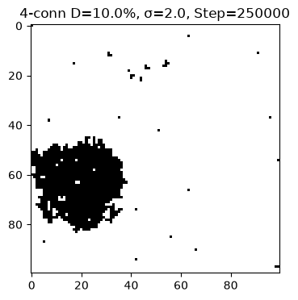
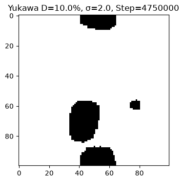
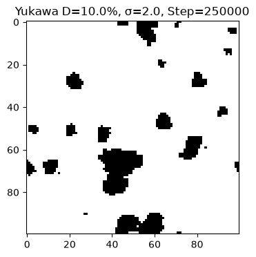
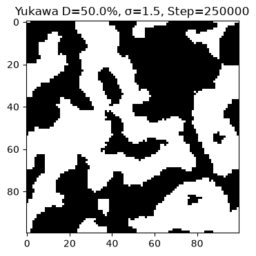

# Плексон-сетевая модель фазовых переходов и крупномасштабной структуры Вселенной

**Plexon Network Model of Phase Transitions and Large-Scale Structure of the Universe**
*2D Monte Carlo study of aggregation: Yukawa vs 4-connectivity*

Автор: Victor Boyko · GitHub: [@chemist2coder](https://github.com/chemist2coder) · jade.cups@gmail.com

---

## О проекте

Репозиторий содержит вычислительную модель (2D, решётка 100×100 узлов, алгоритм Метрополиса), которая исследует, как из **микроскопической агрегации дискретных элементов (плексонов)** возникают **макроскопические структуры** — от изолированных капель (прототип галактик) до сплошной биконтинуальной сетки (прототип космической паутины). Проект связывает статистическую физику (Монте-Карло), полимерную термодинамику (бинодальный/спинодальный распад) и космологию (формирование крупномасштабной структуры).

> **Статус модели.** Это **игрушечная (toy) модель**: она проверяет механизм агрегации и фазового разделения, но **не симулирует пространство-время напрямую** и не претендует на доказательство гипотезы плексонов. Все ограничения честно перечислены в [THEORY.md](THEORY.md) (§12).

Мы сравниваем **две модели взаимодействия**:

| Модель | Тип взаимодействия | Физический смысл |
|---|---|---|
| **4-связность** | только 4 ближайших соседа | жёсткая решётка, «мёртвый камень» |
| **Потенциал Юкавы** | `J(r) = J0·e^(−μr)/r`, радиус `r_cutoff = 4` | мягкое затухающее поле, «живая полимерная среда» |

## Научная цель и проблема

Современные N-body симуляции (Millennium, FLAMINGO) и феноменологические модели (Yadav, 2026 — уравнение Кана–Хилларда) успешно воспроизводят распределение галактик, однако N-body вычислительно дороги, а макроскопические модели **не объясняют микроскопическую природу** фазового перехода. Мы предлагаем альтернативный путь: смоделировать агрегацию плексонов на дискретной решётке.

**Гипотеза:** пространство-время состоит из сети узлов (плексонов); масса и гравитация возникают как результат их агрегации.

**Цель:** показать, что модель с затухающим потенциалом Юкавы воспроизводит два классических механизма полимерной физики — **бинодальный распад** (образование изолированных капель) и **спинодальный распад** (образование сплошной сетки/геля), и что для этого необходим именно *мягкий* потенциал, а не *жёсткая* 4-связность.

## Методология (два этапа)

1. **Скрининг (первичный прогон).** Полная матрица параметров: 4 силы притяжения (J0/λ = 0; 0.5; 1; 3) × 4 плотности (0.5%, 1%, 10%, 50%) × 13 значений поверхностного натяжения σ = **208 комбинаций**, каждая по 20 000 шагов Метрополиса (20 000 × 5 = 100 000 итераций). Цель — найти «вкусные» точки фазового перехода по кривой периметра («пила»).
2. **Глубокий расчёт (deep dive).** По результатам скрининга выбраны **4 точки**; для них проведён длительный расчёт: **4-связность — 2.5 млн шагов**, **Юкава — 5 млн шагов** (для наблюдения эволюции и созревания Оствальда).

**Четыре выбранные точки** (λ = J0 = 3.0 — режим сильного притяжения, доминирующего над тепловым шумом β = 1.0):

| # | Плотность | 4-связность | Юкава | Режим |
|---|---|---|---|---|
| 1 | 10 % | σ = 2.0 (минимум периметра) | σ = 2.0 | бинодаль (капли) |
| 2 | 10 % | σ = 2.5 (скачок периметра) | σ = 10.0 | бинодаль, сильное натяжение |
| 3 | 50 % | σ = 1.5 (начало геля) | σ = 1.5 | спинодаль (гель) |
| 4 | 50 % | σ = 2.0 (стабильный гель) | σ = 2.0 | спинодаль, стабильный гель |

## Ключевые результаты (финальные данные)

Сводка по глубокому расчёту (значения на 250k → финальный шаг):

| Модель | Точка | P_inf (250k → финал) | Периметр (250k → финал) | Max_Size |
|---|---|---|---|---|
| 4-связность 2.5M | 10 %, σ=2.0 | 0.967 → **1.0** | 432 → 152 | 996 → 1030 |
| 4-связность 2.5M | 10 %, σ=2.5 | 0.982 → **1.0** | 402 → 152 | 976 → 994 |
| 4-связность 2.5M | 50 %, σ=1.5 | **1.0** (сразу) | 2214 → 1042 | 4934 |
| 4-связность 2.5M | 50 %, σ=2.0 | **1.0** (сразу) | 2140 → 1004 | 5024 |
| **Юкава 5M** | 10 %, σ=2.0 | 0.299 → **0.483** | 574 → 218 | 292 → 472 |
| **Юкава 5M** | 10 %, σ=10.0 | 0.392 → **0.637** | 562 → 236 | 403 → 655 |
| **Юкава 5M** | 50 %, σ=1.5 | 0.688 → **0.799** | 1312 → 588 | 3376 → 3922 |
| **Юкава 5M** | 50 %, σ=2.0 | 0.688 → **0.720** | 1370 → 588 | 3482 → 3644 |

**Выводы:**

- **4-связность** быстро образует единственный перколирующий кластер (P_inf → 1.0 уже к 500 000 шагам) и далее лишь медленно сглаживает границу (периметр падает), **не меняя топологию** — система «замерзает» в монолит с угловатыми (кубическими) артефактами. Для описания динамической эволюции структур она непригодна.
- **Юкава** демонстрирует классическую полимерную термодинамику: при **10 %** — **бинодальный распад** (изолированные гладкие капли, прототип галактик), при **50 %** — **спинодальный распад** (биконтинуальная сетка, прототип космической паутины). Система продолжает перестраиваться (**созревание Оствальда**: крупные капли/сетка поглощают мелкие) вплоть до 5 млн шагов.

> **Созревание Оствальда (кратко).** Процесс, когда после разделения фаз крупные капли/кластеры «поедают» мелкие: у мелкой капли выше поверхностное натяжение (давление Лапласа ∝ 1/r), поэтому вещество перетекает к крупным. В данных это видно как рост P_inf (0.299→0.483), рост Max_Size (292→472) и падение периметра (574→218). Это и есть «живая эволюция» структуры. Подробно — [THEORY.md](THEORY.md) §6.1.

> **Важная оговорка о статистике.** Каждая точка рассчитана **один раз (один прогон)**; дисперсия результатов по случайным seed не оценена. Учёт статистики (несколько seed с усреднением) — запланированное улучшение (см. THEORY §12).

> **Важная оговорка о «плато».** Полное термодинамическое равновесие на 5 млн шагах **не зафиксировано**: у точек (10 %, σ=10.0) и (50 %, σ=2.0) P_inf выходит на насыщение (~0.64 и ~0.72 соответственно), тогда как (10 %, σ=2.0) и (50 %, σ=1.5) продолжают медленно расти до конца расчёта. Рост носит характер быстрого начального подъёма с медленным выходом на плато (экспоненциальное приближение); для подтверждения насыщения требуются более длинные прогоны (порядка 10–15 млн шагов).


*4-связность (10 %, σ=2.0), 250 000 шагов — рваный угловатый кластер.*


*Юкава (10 %, σ=2.0), 4 750 000 шагов — гладкая изолированная капля.*

## Структура репозитория

```text
plekton/
├── README.md                    # этот файл (краткое описание и результаты)
├── THEORY.md                    # подробная теория (плексоны, Юкава, бинодаль/спинодаль, Ядав, методология)
├── RENAME_MAP.md                # таблица переименований «старое → новое»
├── LICENSE                      # MIT (код)
├── LICENSE-text                 # CC BY 4.0 (тексты/документация)
├── CITATION.cff                 # машиночитаемое цитирование
├── requirements.txt             # зависимости (pip)
├── environment.yml              # окружение conda/miniforge
├── data/
│   ├── screening/               # файлы первичного скрининга (см. README внутри)
│   ├── 4conn_2.5M.csv           # глубокий расчёт 4-связности (2.5 млн шагов)
│   ├── yukawa_2.5M.csv          # глубокий расчёт Юкавы (2.5 млн шагов)
│   ├── yukawa_5M.csv            # финальный расчёт Юкавы (5 млн шагов)
│   └── summary_2.5M.xlsx        # сводка 2.5 млн (обе модели)
├── src/
│   ├── simulation_4conn_2.5M.ipynb
│   ├── simulation_yukawa_2.5M.ipynb
│   └── simulation_yukawa_5M.ipynb
├── figures/
│   ├── 4conn_2.5M/              # кадры эволюции 4-связности (250k…2.25M)
│   ├── yukawa_2.5M/             # кадры эволюции Юкавы (250k…2.25M)
│   └── yukawa_5M/               # кадры эволюции Юкавы (250k…4.75M)
└── gif/                         # анимации эволюции (12 шт.)
    ├── 4conn_D0.1_S2.0.gif  …   # 4-связность, 4 анимации
    ├── yukawa_2.5M_*.gif        # Юкава 2.5M, 4 анимации
    └── yukawa_5M_*.gif          # Юкава 5M, 4 анимации
```

## Анимации (GIF)

Ниже — встроенные анимации полной эволюции (на GitHub они воспроизводятся прямо в тексте):






Полный набор из 12 анимаций — в каталоге [`gif/`](gif/): 4×4-связность (2.5M), 4×Юкава (2.5M), 4×Юкава (5M).

## Файлы данных и код

**Данные:**
- `data/4conn_2.5M.csv` — глубокий расчёт 4-связности, 2.5 млн шагов (колонки: `p_init, lam, sigma, step, density, P_inf, perimeter, max_size`).
- `data/yukawa_2.5M.csv` — глубокий расчёт Юкавы, 2.5 млн шагов (колонки: `p_init, J0, sigma, step, density, P_inf, perimeter, max_size`).
- `data/yukawa_5M.csv` — финальный расчёт Юкавы, 5 млн шагов.
- `data/summary_2.5M.xlsx` — сводка 2.5 млн (листы `deep_dive_4conn_v2`, `deep_dive_yukawa_v2`).
- `data/screening/` — файлы первичного скрининга 208 точек (20 000 шагов); список — в README внутри папки.

**Код:**
- `src/simulation_4conn_2.5M.ipynb` — 4-связность (L=100, λ=3.0, 2.5 млн шагов).
- `src/simulation_yukawa_2.5M.ipynb` — Юкава 2.5 млн (L=100, J0=3.0, μ=0.5, r_cutoff=4).
- `src/simulation_yukawa_5M.ipynb` — Юкава 5 млн (финальный).

Соответствие исходным именам файлов — в `RENAME_MAP.md`.

## Установка и запуск

**Рекомендуемый путь (conda/miniforge, без pip):**
```bash
conda env create -f environment.yml
conda activate gravitation   # имя окружения из environment.yml
```

**Альтернатива (pip):**
```bash
git clone <URL-репозитория>   # вставьте URL после публикации репозитория
cd plekton
python -m venv .venv && source .venv/bin/activate   # Windows: .venv\Scripts\activate
pip install -r requirements.txt
```

Запуск ноутбуков — в Jupyter: `jupyter notebook src/simulation_yukawa_5M.ipynb`. Параметры (L=100, J0=3.0, μ=0.5, r_cutoff=4, β=1.0, точки) заданы в начале каждого ноутбука.

## Литература

1. N. Yadav, *A spinodal decomposition model for the large-scale structure of the universe*, **Current Physics** 3, e27723348461389 (2026). DOI: [10.2174/0127723348461389260423123250](https://doi.org/10.2174/0127723348461389260423123250).
2. J. W. Cahn, J. E. Hilliard, *Free energy of a nonuniform system. I. Interfacial free energy*, **J. Chem. Phys.** 28, 258 (1958). DOI: [10.1063/1.1744102](https://doi.org/10.1063/1.1744102).
3. V. Springel et al., *Simulations of the formation, evolution and clustering of galaxies and quasars*, **Nature** 435, 629 (2005). DOI: [10.1038/nature03597](https://doi.org/10.1038/nature03597).
4. J. Schaye et al., *The FLAMINGO project: cosmological hydrodynamical simulations for large-scale structure and galaxy cluster surveys*, **MNRAS** 526, 4978 (2023). DOI: [10.1093/mnras/stad2419](https://doi.org/10.1093/mnras/stad2419).

## Лицензия и цитирование

- **Код** — лицензия **MIT** (файл `LICENSE`).
- **Тексты и документация** (README, THEORY) — лицензия **CC BY 4.0** (файл `LICENSE-text`).
- Как цитировать — файл `CITATION.cff`. После получения DOI через Zenodo он будет добавлен сюда и в `CITATION.cff` (пошаговая инструкция по Zenodo — в [THEORY.md](THEORY.md), §16).

---

*Подробная теория, вывод формул, словарь обозначений и полный разбор результатов — в [THEORY.md](THEORY.md).*
