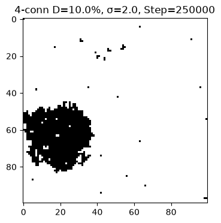
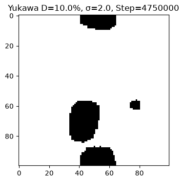
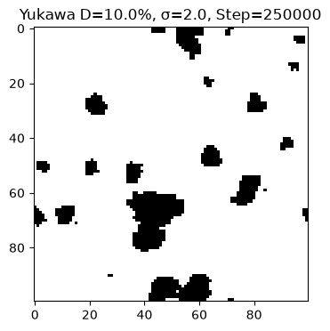
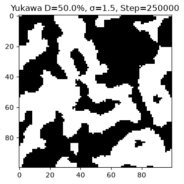

# Plexon Network Model of Phase Transitions and Large-Scale Structure of the Universe

*2D Monte Carlo study of aggregation: Yukawa vs 4-connectivity*

Author: Victor Boyko · GitHub: [@chemist2coder](https://github.com/chemist2coder) · jade.cups@gmail.com

*Русская версия — [README.ru.md](README.ru.md).*

---

## About the project

This repository contains a computational model (2D, a 100×100 lattice, the Metropolis algorithm) that investigates how **macroscopic structures** — from isolated droplets (prototype of galaxies) to a contiguous bicontinuous network (prototype of the cosmic web) — emerge from the **microscopic aggregation of discrete elements (plexons)**. The project bridges statistical physics (Monte Carlo), polymer thermodynamics (binodal/spinodal decomposition), and cosmology (formation of large-scale structure).

> **Status of the model.** The model we propose can be called a *toy model*; its aim is a **deliberate test of the hypothesis in 2D** (with a subsequent move to 3D). It shows that the plexon aggregation mechanism actually produces the expected structures (droplets at 10%, a network at 50%), i.e. the result is *consistent* with the hypothesis. The 2D model, however, covers **only the aggregation step** — we do not simulate spacetime directly; strengthening the confirmation by calculation requires the move to 3D and a direct comparison with astrophysical data. What is confirmed and what remains a hypothesis — see [THEORY.md](THEORY.md) (§5, §11–§12).

> **Status of the work.** This is a first, preliminary examination of the hypothesis, written by an author whose background is chemistry (polymer physical chemistry) rather than professional cosmology. This is not a weakness but a vantage point: polymer physics is the native language of binodal/spinodal decomposition — the toolkit used throughout — and the Cahn–Hilliard framework itself comes from chemical physics (J. W. Cahn was a metallurgist; J. E. Hilliard a chemical engineer). The work deliberately restricts its claims to what the 2D model demonstrates and marks every untested part of the hypothesis explicitly; its aim is to open a discussion, not to announce a finished theory.

We compare **two interaction models**:

| Model | Interaction | Physical meaning |
|---|---|---|
| **4-connectivity** | only the 4 nearest neighbours | hard lattice, "dead stone" |
| **Yukawa potential** | J(r) = J0·e^(−μr)/r, cutoff r_cutoff = 4 | soft screened field, "living polymer medium" |

## Scientific goal and problem

Modern N-body simulations (Millennium, FLAMINGO) and phenomenological models (Yadav, 2026 — the Cahn–Hilliard equation) successfully reproduce the distribution of galaxies, yet N-body methods are computationally expensive and macroscopic models do **not explain the microscopic nature** of the phase transition. We propose an alternative route: simulating the aggregation of plexons on a discrete lattice.

**Hypothesis:** spacetime is a network of nodes (plexons); mass and gravity arise from their aggregation.

**Goal:** to show that a model with a screened Yukawa potential reproduces two classical mechanisms of polymer physics — **binodal decomposition** (formation of isolated droplets) and **spinodal decomposition** (formation of a contiguous network/gel) — and that this requires a *soft* potential rather than a *hard* 4-connectivity.

## Methodology (two stages)

1. **Screening (initial run).** Full parameter matrix: 4 couplings (J0/λ = 0; 0.5; 1; 3) × 4 densities (0.5%, 1%, 10%, 50%) × 13 surface-tension values σ = **208 combinations**, each for 20,000 Metropolis steps (20,000 × 5 = 100,000 moves). The goal is to locate the "interesting" points of the phase transition on the perimeter curve ("sawtooth").
2. **Deep dive.** Four points were selected and run long: **4-connectivity — 2.5 million steps**, **Yukawa — 5 million steps**, to observe evolution and Ostwald ripening.

**The four selected points** (λ = J0 = 3.0 — the regime of strong attraction dominating the thermal noise β = 1.0):

| # | Density | 4-connectivity | Yukawa | Regime |
|---|---|---|---|---|
| 1 | 10 % | σ = 2.0 (perimeter minimum) | σ = 2.0 | binodal (droplets) |
| 2 | 10 % | σ = 2.5 (perimeter jump) | σ = 10.0 | binodal, strong tension |
| 3 | 50 % | σ = 1.5 (gel onset) | σ = 1.5 | spinodal (gel) |
| 4 | 50 % | σ = 2.0 (stable gel) | σ = 2.0 | spinodal, stable gel |

## Key results (final data)

Summary of the deep dive (values at 250k → final step):

| Model | Point | P_inf (250k → final) | Perimeter (250k → final) | Max_Size |
|---|---|---|---|---|
| 4-connectivity 2.5M | 10 %, σ=2.0 | 0.967 → **1.0** | 432 → 152 | 996 → 1030 |
| 4-connectivity 2.5M | 10 %, σ=2.5 | 0.982 → **1.0** | 402 → 152 | 976 → 994 |
| 4-connectivity 2.5M | 50 %, σ=1.5 | **1.0** (at once) | 2214 → 1042 | 4934 |
| 4-connectivity 2.5M | 50 %, σ=2.0 | **1.0** (at once) | 2140 → 1004 | 5024 |
| **Yukawa 5M** | 10 %, σ=2.0 | 0.299 → **0.483** | 574 → 218 | 292 → 472 |
| **Yukawa 5M** | 10 %, σ=10.0 | 0.392 → **0.637** | 562 → 236 | 403 → 655 |
| **Yukawa 5M** | 50 %, σ=1.5 | 0.688 → **0.799** | 1312 → 588 | 3376 → 3922 |
| **Yukawa 5M** | 50 %, σ=2.0 | 0.688 → **0.720** | 1370 → 588 | 3482 → 3644 |

**Conclusions:**

- **4-connectivity** rapidly forms a single percolating cluster (P_inf → 1.0 already by 500,000 steps) and thereafter only slowly smooths its boundary (perimeter falls), **without ever re-topologising** — the system "freezes" into a monolith with angular (lattice) artifacts. It is unsuitable for describing dynamic structure evolution.
- **Yukawa** exhibits classical polymer thermodynamics: at **10 %** — **binodal decomposition** (isolated smooth droplets, a prototype of galaxies); at **50 %** — **spinodal decomposition** (a bicontinuous network, a prototype of the cosmic web). The system keeps rearranging (**Ostwald ripening**: large droplets/network absorb small ones) up to 5 million steps.

> **Ostwald ripening (briefly).** The process of large droplets/clusters absorbing smaller formations after phase separation: a small droplet has higher surface tension (Laplace pressure ∝ 1/r), so matter tends to flow over and merge with the larger aggregates. In the data we see this as a continuous rise in P_inf (0.299→0.483), a rise in Max_Size (292→472), and a fall in perimeter (574→218) — the "living evolution" of the structure. Details: THEORY §6.1.

> **Caveat about statistics.** Each point was run by us **once (a single run)**; the variance across random seeds has not been estimated by us. Statistics (several seeds with averaging) is a planned improvement (see THEORY §12) — of both the Python code and the next stage of testing the hypothesis.

> **Caveat about the "plateau".** Full thermodynamic equilibrium was not reached at 5 million steps: points (10 %, σ=10.0) and (50 %, σ=2.0) saturate (~0.64 and ~0.72), whereas (10 %, σ=2.0) and (50 %, σ=1.5) still grow slowly until the end. The growth resembles a fast initial rise with a slow approach to a plateau (exponential relaxation); confirming saturation requires longer runs (of order 10–15 million steps).


*4-connectivity (10 %, σ=2.0), 250,000 steps — a ragged angular cluster.*


*Yukawa (10 %, σ=2.0), 4,750,000 steps — a smooth isolated droplet.*

## Animations (GIF)

Embedded full-evolution animations (they play inline on GitHub):






All 12 animations — in the [`gif/`](gif/) folder: 4×4-connectivity (2.5M), 4×Yukawa (2.5M), 4×Yukawa (5M).

## Repository structure

```text
├── README.md                    # main README (English, this file)
├── README.ru.md                 # README in Russian
├── THEORY.md                    # detailed theory (English)
├── THEORY.ru.md                 # detailed theory (Russian)
├── LICENSE                      # MIT (code)
├── LICENSE-text                 # CC BY 4.0 (text/documentation)
├── CITATION.cff                 # machine-readable citation
├── requirements.txt             # pip dependencies
├── environment.yml              # conda/miniforge environment
├── data/
│   ├── screening/               # primary screening files (see README inside)
│   ├── 4conn_2.5M.csv           # 4-connectivity deep dive (2.5M steps)
│   ├── yukawa_2.5M.csv          # Yukawa deep dive (2.5M steps)
│   ├── yukawa_5M.csv            # final Yukawa run (5M steps)
│   └── summary_2.5M.xlsx        # 2.5M summary (both models)
├── src/
│   ├── simulation_4conn_2.5M.ipynb
│   ├── simulation_yukawa_2.5M.ipynb
│   └── simulation_yukawa_5M.ipynb
├── experiments/                # GPU variants (PyTorch/CuPy) — no speedup, see README inside
│   ├── simulation_4conn_CUDA.ipynb
│   └── simulation_yukawa_GPU.ipynb
├── figures/
│   ├── 4conn_2.5M/              # evolution frames (250k…2.25M)
│   ├── yukawa_2.5M/             # evolution frames (250k…2.25M)
│   └── yukawa_5M/               # evolution frames (250k…4.75M)
└── gif/                         # 12 evolution animations
```

## Data files and code

**Data:**
- `data/4conn_2.5M.csv` — 4-connectivity deep dive, 2.5M steps (columns: `p_init, lam, sigma, step, density, P_inf, perimeter, max_size`).
- `data/yukawa_2.5M.csv` — Yukawa deep dive, 2.5M steps (columns: `p_init, J0, sigma, step, density, P_inf, perimeter, max_size`).
- `data/yukawa_5M.csv` — final Yukawa run, 5M steps.
- `data/summary_2.5M.xlsx` — 2.5M summary (sheets `deep_dive_4conn_v2`, `deep_dive_yukawa_v2`).
- `data/screening/` — primary screening files for the 208 points (20,000 steps); contents and the parameter matrix — in [data/screening/README.md](data/screening/README.md).

**Code:**
- `src/simulation_4conn_2.5M.ipynb` — 4-connectivity (L=100, λ=3.0, 2.5M steps).
- `src/simulation_yukawa_2.5M.ipynb` — Yukawa 2.5M (L=100, J0=3.0, μ=0.5, r_cutoff=4).
- `src/simulation_yukawa_5M.ipynb` — Yukawa 5M (final).

## Installation and run

**Recommended (conda/miniforge, without pip):**
```bash
conda env create -f environment.yml
conda activate gravitation   # environment name from environment.yml
```

**Alternative (pip):**
```bash
git clone <repo-URL>   # insert the URL after publication
cd <repo>
python -m venv .venv && source .venv/bin/activate   # Windows: .venv\Scripts\activate
pip install -r requirements.txt
```

Run the scripts (.ipynb) in Jupyter: `jupyter notebook src/simulation_yukawa_5M.ipynb`. The parameters (L=100, J0=3.0, μ=0.5, r_cutoff=4, β=1.0, the points) are set at the top of each script.

## References

1. N. Yadav, *A spinodal decomposition model for the large-scale structure of the universe*, Current Physics **3**, e27723348461389 (2026). DOI: [10.2174/0127723348461389260423123250](https://doi.org/10.2174/0127723348461389260423123250).
2. J. W. Cahn, J. E. Hilliard, *Free energy of a nonuniform system. I. Interfacial free energy*, J. Chem. Phys. **28**, 258 (1958). DOI: [10.1063/1.1744102](https://doi.org/10.1063/1.1744102).
3. V. Springel et al., *Simulations of the formation, evolution and clustering of galaxies and quasars*, Nature **435**, 629 (2005). DOI: [10.1038/nature03597](https://doi.org/10.1038/nature03597).
4. J. Schaye et al., *The FLAMINGO project: cosmological hydrodynamical simulations for large-scale structure and galaxy cluster surveys*, MNRAS **526**, 4978 (2023). DOI: [10.1093/mnras/stad2419](https://doi.org/10.1093/mnras/stad2419).

## License and citation

- **Code** — MIT license (file `LICENSE`).
- **Text and documentation** (README, THEORY) — CC BY 4.0 (file `LICENSE-text`).
- How to cite — file `CITATION.cff`. After the Zenodo DOI is obtained it will be added here and to `CITATION.cff`.

---

*Detailed theory, notation glossary, methodology, and the full analysis — in [THEORY.md](THEORY.md) (English) / [THEORY.ru.md](THEORY.ru.md) (Russian). The arXiv preprint — in `arXiv/preprint.md` (English)*.

## Testing & QA

Development used AI-assisted coding tools; the scientific content — the hypothesis, the physical model, the choice of parameters and methodology, and the interpretation and verification of the results — is the author's. During shakedown the code was tested for robustness against crashes and interruptions (a checkpoint/resume system); the perimeter bug ("checkerboard"), the Yukawa double-counting, and an off-by-one in saving the final snapshot were fixed; the results were cross-checked against the primary screening. The computations are currently stable and reproducible (data in `data/`).
