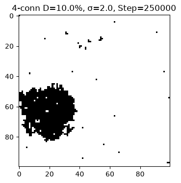
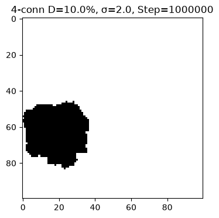
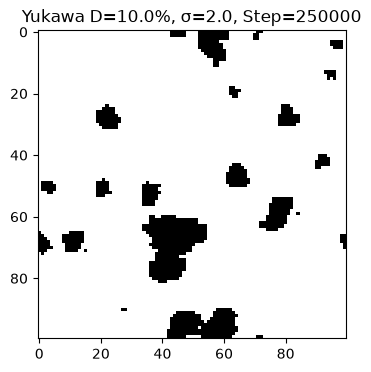
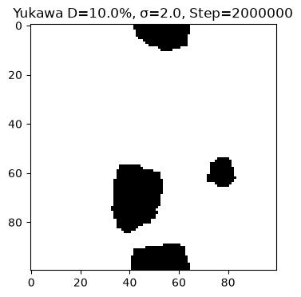
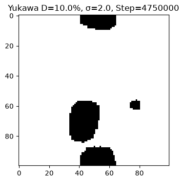
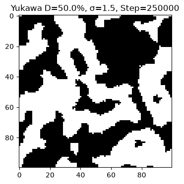
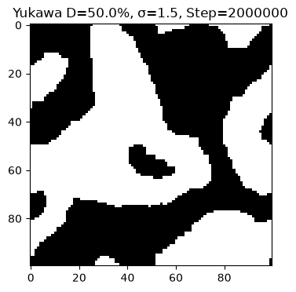
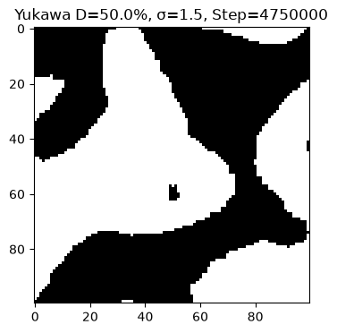
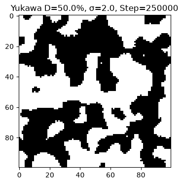

# Теоретическая основа плексон-сетевой модели фазовых переходов и крупномасштабной структуры Вселенной

*Теория, словарь обозначений, методология, результаты, сравнение с Yadav (2026).*

*Русская версия. Основной документ — на английском: [THEORY.md](THEORY.md).*

## 1. Введение: от феноменологии к микроскопии

Современные исследования крупномасштабной структуры Вселенной (КМС) всё чаще используют термодинамические подходы. В работе Nitish Yadav (2026) [1] уравнение Кана–Хилларда — классическая модель спинодального распада полимерных смесей — применяется к «двухкомпонентной жидкости» (материя + тёмная энергия) и воспроизводит войды, стенки и филаменты, согласуясь с обзорами DES и Subaru. Это макроскопический, феноменологический подход: он постулирует жидкость и решает континуальное уравнение, но **не объясняет, из чего эта жидкость состоит**.

В нашей работе мы предлагаем **микроскопический механизм**. Мы предполагаем, что пространство-время состоит из дискретных узлов — **плексонов**, — а гравитация, масса и крупномасштабная структура возникают из их **агрегации**. Для описания взаимодействия используется **потенциал Юкавы** — мягкое, затухающее с расстоянием поле, которое математически аналогично индуктивному эффекту в полимерных цепях (затухание влияния заместителя через 4–5 связей).

Таким образом, если Yadav моделирует *следствие* (жидкость разделяется на фазы), то мы моделируем *причину* (дискретные элементы агрегируются, порождая те же фазы).

> **Статус модели.** Настоящая работа — **игрушечная (toy) модель**, но она задумана как **первая, частичная проверка гипотезы в 2D** (с последующим переходом к 3D): она показывает, что механизм агрегации плексонов действительно порождает ожидаемые структуры — капли (бинодаль) и сетку (спинодаль) — то есть результат **согласуется с гипотезой**. Однако модель проверяет **только агрегацию** и не симулирует пространство-время напрямую; подтвердить, что плексоны — реальные узлы пространства-времени, может лишь 3D-обобщение и сравнение с астрофизическими данными. Что подтверждено расчётом, а что остаётся гипотезой — §5 и §11–§12.

> **О статусе работы.** Это первичное (предварительное) рассмотрение гипотезы, выполненное автором — **химиком-полимерщиком**, а не профессиональным космологом. Это возможность взглянуть на проблему космологии с другого ракурса — ракурса физики полимеров: фазовое разделение, возникающее при полимер-аналогичных превращениях, и тесно связанные с ним бинодальный/спинодальный распад; именно этот инструментарий здесь основной (само уравнение Кана–Хилларда вышло из химической физики — Дж. Кан был металлургом, Дж. Хиллиард — химиком-технологом). Работа сознательно ограничивает утверждения тем, что показывает 2D-модель, и явно помечает все недоказанные части гипотезы; цель работы — открыть обсуждение, а не объявить готовую теорию, и попробовать себя в коде Python.

## 2. Что такое плексон и откуда берётся материя

**Плексон — это не частица, летящая в пустоте. Это узел сети.** Плексон — фундаментальная сущность: не частица, не волна, не точка в пространстве. Сеть образует само пространство-время; плексон не «находится в» пространстве-времени, а **создаёт** его. Если нет узла — нет сети.

Простая аналогия — рыболовная сеть: узлы — плексоны, нити — связи, ячейки — войды (пространство). Если сеть растянуть — ячейки увеличатся; если сжать — уменьшатся; но узлы остаются узлами, а нити — нитями. В первичном приближении мы рассматриваем сеть на плоскости 2D («сеть, положенная на стол») и не учитываем ни трёхмерность самой сети, ни 3D-объём, в котором она размещена.

**Гравитация как натяжение сети (аналог упругих сил).** С самого начала мы рассматриваем гравитацию **не как фундаментальную силу между массами, а как натяжение сети плексонов** — по аналогии с упругими силами в растянутой сети. Комок из N узлов (агрегат) локально оттягивает и напрягает соседние связи; сеть стремится снять это напряжение и стягивает соседние узлы к комку — как растянутая нить тянет обратно. Чем больше узлов в комке (чем больше масса), тем сильнее локальное натяжение и тем сильнее стягивание: притяжение оказывается пропорциональным массе, без «мистического дальнодействия». Оба тела испытывают равное и противоположное натяжение (F = −F), но тело с меньшим числом узлов (меньшей инерцией) ускоряется сильнее — это и есть асимметрия падения. **Важная оговорка:** наша сеть **лабильна** — связи рвутся и перестраиваются, узлы агрегируют, топология меняется. Поэтому «упругость» здесь — метафора натяжения, а не классическая теория упругости с фиксированными пружинами (закон Гука): фиксированная решётка даёт лишь линейную упругость, а не гравитацию. Нелинейность, нужная для гравитации, возникает из агрегации и перколяции, а не из закона Гука.

**О термине.** Мы вводим и используем термин «плексон» (от латинского *plexus* — «сплетение») в **новом, собственном смысле** — «узел сети, образующей пространство-время»; в физике и космологии в этом значении слово не занято.

> Важно: само слово «plexon» **не уникально** — оно существует вне физики (например, компания **Plexon Inc.** — оборудование для нейрофизиологических исследований), поэтому наш термин — не новое слово, а **новое физическое значение**. Изначально мы использовали термин «хронон», однако он перегружен в литературе и означает совсем другое:
>- *хронон* (Леви, 1927) — гипотетический квант времени;
>- *khronon* в гравитации Хоржавы — скалярное поле, задающее слоение;
>- *Chronon Field Theory* (2025) — маргинальная попытка вывести гравитацию и калибровочные взаимодействия из «темпорального поля» Φ(x).

Наш объект — иной: узел сети, образующей пространство-время. Чтобы избежать путаницы, принят новый термин **плексон**; теория называется **плексон-сетевая теория гравитации (ПСТ)**.

**Агрегация и масса.** У плексона есть «вес» — мера присутствия. Одиночный плексон имеет вес 1; агрегат из N плексонов — вес N. **Масса — это коллективное свойство агрегации, а не изначальное свойство частицы**: масса агрегата пропорциональна N (M ∝ N). Это гравитационный «заряд».

Масштабы: одиночный плексон N = 1; маленький кластер N ≈ 10; атом N ≈ 10⁶⁰; звезда N ≈ 10¹²⁰; чёрная дыра N → ∞ *(иллюстративная оценка гипотезы, не расчёт — приводится только как образ, в вычислениях не используется)*.

**Дуализм «поле–тело».** Одиночный плексон или разреженная сеть ведут себя как **поле**; агрегат или плотная сеть — как **тело**. Это не два разных объекта, а два режима одной сети — как вода и лёд.

## 3. Энергия системы и словарь обозначений

Система стремится минимизировать свободную энергию. В нашей модели энергия (действие) задаётся как

**S = −λ·Σ N² + σ·Perimeter**,

а в варианте с полем Юкавы — как

**S = −(1/2)·J0 · Σᵢ Σ_{j≠i} (e^(−μ rᵢⱼ) / rᵢⱼ) · Nᵢ Nⱼ + σ · Perimeter**.

**Расшифровка операторов:**
- **Σ N²** — сумма по всем кластерам квадрата числа узлов N в кластере (знак минус: агрегация выгодна).
- **Σᵢ Σ_{j≠i}** — двойная сумма по всем парам **разных** узлов (j ≠ i): узел не взаимодействует сам с собой (при j = i расстояние r = 0, и сила 1/r расходится).
- **Nᵢ, Nⱼ** — занятость узла: 1 = плексон (занят), 0 = пусто; слагаемое отлично от нуля только для занятых узлов.
- **rᵢⱼ** — расстояние между узлами i и j (в ячейках решётки).
- **e^(−μ rᵢⱼ) / rᵢⱼ** — потенциал Юкавы: 1/r — дальнодействие, e^(−μr) — экранирование.
- **J0** — сила (амплитуда) притяжения; **μ** — параметр экранирования; **σ** — поверхностное натяжение; **Perimeter** — суммарная длина границы «материя/пустота».
- **½** — фактор, устраняющий двойной счёт каждой пары (i,j) и (j,i) в полной сумме. В коде он не требуется: энергия считается локально (по одному занятому узлу), поэтому каждая пара учитывается один раз.

**Словарь обозначений** (расшифровка, что есть что):

| Обозначение | Название | Смысл в модели | Значение |
|---|---|---|---|
| **λ (лямбда)** | сила агрегации | насколько энергетически выгодно слипание (знак «минус» в −λΣN² означает: агрегация выгодна); λc — порог агрегации | λ = 3.0 (в 4-связности) |
| **σ (сигма)** | поверхностное натяжение | штраф за рваные границы (член +σ·Perimeter); «плохой растворитель», сжимающий клубок в глобулу | список 0…50 (см. §7) |
| **β (бета)** | обратная температура | тепловой шум (1/kT); шаг принимается при ΔS ≤ 0 или с вероятностью exp(−β·ΔS) | β = 1.0 |
| **J0** | сила притяжения ы | амплитуда потенциала; «насколько плексоны любят друг друга»; усилен, «чтобы притяжение победило энтропию» | J0 = 3.0 |
| **μ (мю)** | параметр экранирования ы | обратная длина экранирования («масса поля»); чем больше μ, тем быстрее затухает сила | μ = 0.5 |
| **r_cutoff** | радиус обрезания | считаем взаимодействие только в радиусе 4 клеток («тот самый 5-й атом»); на 4-й клетке сила ≈ e⁻² ≈ 0.13 | r_cutoff = 4 |
| **P_inf** | доля в гигантском кластере | размер наибольшего кластера / общее число частиц; 0 — всё рассеяно, 1 — монолит | см. таблицы |
| **Perimeter** | периметр (граница) | сумма рёбер, где занятая клетка касается пустой; чем ниже, тем компактнее структура | см. таблицы |
| **Max_Size** | размер наибольшего кластера | абсолютное число частиц в крупнейшем кластере (читать вместе с P_inf) | см. таблицы |
| **density** | фактическая плотность | измеренная доля занятых узлов (должна совпадать с заданной) | 0.5 %, 1 %, 10 %, 50 % |

**Алгоритм.** Метрополис (Монте-Карло) с обменом занятого и пустого узла — общее число частиц (плотность) сохраняется. Шаг принимается, если ΔS ≤ 0, иначе — с вероятностью exp(−β·ΔS).

**Граничные условия.** Решётка 100×100 с **периодическими граничными условиями (тор)**: она замыкается сама на себя.

## 4. Что такое Юкава (подробный отчёт)

### 4.1. Историческая справка

В 1935 году японский физик Хидэки Юкава искал формулу для сильного взаимодействия, удерживающего протоны и нейтроны в ядре. Обычные силы (гравитация, электричество) падают как 1/r² и действуют бесконечно далеко — а ядро слишком маленькое. Юкава предположил, что сила переносится частицами (мезонами), **имеющими массу**: если частица-переносчик безмассовая (фотон), сила 1/r² и бесконечна; если у неё есть масса — поле «устаёт» и затухает экспоненциально.

### 4.2. Формула и её члены

**V(r) = −J0 · e^(−μ r) / r**

- **r (расстояние)** — чем дальше плексоны друг от друга, тем слабее сила.
- **1/r (геометрия)** — сила распространяется во все стороны (как круги на воде), поэтому падает обратно пропорционально расстоянию.
- **e^(−μr) (экран)** — главный множитель: при μ > 0 сила затухает экспоненциально. При μ = 0.5 на расстоянии 5–6 клеток сила становится пренебрежимо малой. Это «экранирование» — как если бы между плексонами стояла среда, гасящая притяжение.
- **J0 (сила)** — амплитуда: насколько сильно плексоны притягиваются. При J0 = 0 притяжения нет.

### 4.3. Зачем это нужно (прорыв по сравнению с 4-связностью)

В 4-связности плексон чувствует только 4 соседа вплотную: если соседняя клетка пустая — взаимодействия нет. Юкава делает плексоны «мягкими»: каждый плексон создаёт вокруг себя поле (ореол) радиусом 4 клетки и притягивает всё, что в этом радиусе. Это соответствует (а) индуктивному эффекту в полимерах и (б) реальной гравитации, где тела действуют друг на друга через пространство, а не только при касании.

### 4.4. Почему r_cutoff = 4

Считать взаимодействие «все со всеми» — это O(N²) (компьютер «умрёт»). Мы обрезаем радиус на 4 клетках: при μ = 0.5 на 4-й клетке сила падает до e⁻² ≈ 0.13 от исходной — дальше ею можно пренебречь. Это стандартный приём молекулярной динамики.

## 5. Гибкий J0 и «затухание по цепи» (индуктивный эффект)

Идея «гибкого J0» возникла из полимерной химии. В макромолекуле смещение электронной плотности от заместителя влияет максимум на 5 связей атомов углерода: между атомами 1 и 6 связь бесконечно мала и не вносит существенного вклада в связь 1–2. Влияние затухает **постепенно, но не обрывается в ноль мгновенно**.

Предложение задать взаимодействие вручную — J(1)=3, J(2)=1, J(3)=0.5, J(4)=0.01 — по сути уже реализуется функцией Юкавы: при J0 = 3 и μ = 0.5 на расстояниях 1, 2, 3, 4 сила равна ≈ 1.82, 0.55, 0.22, 0.10. То есть **Юкава и есть «гибкий J0»**: плавное затухание связи по цепи. Если затухание сделать неестественно резким (на 4-м соседе — обрыв) — получим жёсткую 4-связность; если плавным (Юкава) — получим мягкое поле, способное формировать гладкие структуры.

Отсюда же идея **лабильности**: в реальной сети связи рвутся и восстанавливаются, и при восстановлении может встраиваться влияние другого тела. В данной 2D-модели сеть фиксирована (узлы занимаются/освобождаются), а «лабильность» эффективно моделируется именно затухающим полем Юкавы.

## 6. Бинодальный и спинодальный распад: как рождается структура

Расслоение полимерного раствора идёт двумя механизмами, разделяемыми фазовой диаграммой (энергия Гиббса G по концентрации c):

- **Бинодаль** — граница метастабильности; распад идёт через **нуклеацию и рост**: образуются изолированные зародыши, которые растут.
- **Спинодаль** — область, где однородная смесь **абсолютно нестабильна** (∂²G/∂c² < 0): любая микроскопическая флуктуация плотности мгновенно растёт, и система спонтанно распадается на две фазы.

**Ключевое соотношение (наша гипотеза):** если **скорость роста частиц больше скорости их образования** — это **бинодаль**, и мы получаем отдельные частицы (мало узлов). Если **скорость образования узлов больше скорости их роста** — образуется **гель** (сплошная сетка). **Верхняя точка бифуркации = Большой взрыв** — момент, когда система теряет устойчивость.

**В нашей модели** роль концентрации c играет плотность плексонов, а роль энергии Гиббса G — действие S. Плотность выбирает режим:

- **Низкая плотность (10 %)** → **бинодальный распад**: изолированные гладкие капли (глобулы). Космологическая интерпретация — рождение отдельных объектов: галактик и их скоплений.
- **Высокая плотность (50 %)** → **спинодальный распад**: биконтинуальная сетка (гель), где пустоты и нити пронизывают друг друга. Космологическая интерпретация — **космическая паутина** (филаменты и войды).

Дальнейшие следствия (гипотезы, см. §11): тёмная материя = «каркас геля» (агрегированные плексоны, не сжавшиеся до звёзд); тёмная энергия = «растворитель» (разреженный фон одиночных плексонов).

### 6.1. Созревание Оствальда (Ostwald ripening) — что это и как проявляется в модели

**Что это такое.** Созревание Оствальда — это процесс «поедания» мелких капель крупными, который идёт уже **после** того, как фазы разделились. Назван по имени немецкого химика **Вильгельма Оствальда**, описавшего его в 1896 году на примере осадков и эмульсий.

**Физическая причина.** У мелкой капли отношение поверхности к объёму больше, чем у крупной. Из-за поверхностного натяжения (давление Лапласа ∝ 1/r) вещество на выпуклой поверхности мелкой капли имеет **более высокий химический потенциал**, чем на крупной. Поэтому вещество «растворяется» из мелких капель и «осаждается» на крупных: **крупные растут, мелкие исчезают**. В результате общее число капель уменьшается, средний размер растёт, а суммарная площадь границ (поверхностная энергия) падает.

**Как это выглядит в наших данных (Юкава, 5 млн шагов).** Ровно эта картина видна в расчёте:

| Признак | Направление | Пример (10 %, σ=2.0) |
|---|---|---|
| P_inf (доля в крупнейшем кластере) | растёт | 0.299 → 0.483 |
| Perimeter (суммарная длина границ) | падает | 574 → 218 |
| Max_Size (размер крупнейшего кластера) | растёт | 292 → 472 |

То есть крупный кластер растёт за счёт поглощения мелких, а общая длина границы «материя–пустота» сокращается — это и есть созревание Оствальда.

**Почему 4-связность его не показывает.** В жёсткой 4-связности система мгновенно сливается в один монолит (P_inf → 1.0 уже к 500 000 шагов) и «замерзает»: дальше идёт лишь медленное сглаживание границы, но перестройка топологии (поглощение мелких кластеров) уже невозможна. Созревание Оствальда — **динамический процесс перестройки**, поэтому он наблюдается только в мягком поле Юкавы.

**Космологический смысл.** Созревание Оствальда — аналог слияния галактик и укрупнения скоплений со временем: мелкие структуры поглощаются крупными, сеть/капли огрубляются. Это и есть «живая эволюция» крупномасштабной структуры, в отличие от застывшего монолита 4-связности.

## 7. Методология расчёта

### 7.1. Параметры модели

| Параметр | Значение |
|---|---|
| Решётка | 100×100 = 10 000 узлов |
| Границы | периодические (тор) |
| Алгоритм | Метрополис, обмен «занятый ↔ пустой» (сохраняет плотность) |
| β (обратная температура) | 1.0 |
| J0 / λ (притяжение) | {0.0, 0.5, 1.0, 3.0} (скрининг); 3.0 (deep dive) |
| μ (экранирование) | 0.5 (фиксировано на этапе скрининга) |
| r_cutoff | 4 |
| Плотности | {0.005, 0.01, 0.1, 0.5} → 0.5 %, 1 %, 10 %, 50 % |
| σ (натяжение) | {0, 0.25, 0.5, 1, 1.5, 2, 2.5, 5, 7.5, 10, 15, 25, 50} |

**Аппаратное обеспечение.** Расчёты выполнены на настольном компьютере (домашняя сборка): Windows 10 Pro 22H2 (64-бит); CPU AMD FX-6300 (6 ядер) @ 3.5 ГГц; GPU NVIDIA GeForce GTX 1650 (4 ГБ); RAM 16 ГБ.

### 7.2. Этап 1 — скрининг

Полная матрица: 4 силы × 4 плотности × 13 σ = **208 комбинаций**, каждая **20 000 шагов** (20 000 × 5 = 100 000 итераций). Это черновой быстрый прогон для поиска «вкусных» точек фазового перехода по кривой P_inf(σ) и периметра. Результаты скрининга (фрагмент, 20k шагов; 4-связность λ=3.0 против Юкавы J0=3.0):

| Плотность | σ | 4-связность P_inf | Юкава P_inf | 4-связность периметр | Юкава периметр |
|---|---|---|---|---|---|
| 10 % | 0.0 | 0.995 | 0.004 | 1834 | 3608 |
| 10 % | 2.0 | 0.942 | 0.088 | 618 | 1032 |
| 10 % | 10.0 | 0.636 | 0.098 | 936 | 976 |
| 10 % | 50.0 | 0.796 | 0.098 | 856 | 1074 |
| 50 % | 0.0 | 1.000 | 0.048 | 8654 | 10056 |
| 50 % | 2.0 | 1.000 | 0.734 | 2886 | 2628 |
| 50 % | 10.0 | 1.000 | 0.353 | 2792 | 2576 |

Наблюдения: 4-связность мгновенно коллапсирует в один кластер (P_inf ≈ 1); Юкава при 10 % держит низкий P_inf (много отдельных капель — бинодаль), при 50 % даёт «рыхлый» динамичный гель (спинодаль).

> Приведён фрагмент (ключевые строки); **полные данные всех 208 комбинаций — в `data/screening/`** (состав файлов и матрица параметров — в [data/screening/README.md](data/screening/README.md)).

### 7.3. Этап 2 — глубокий расчёт (deep dive)

На основе скрининга отобраны 4 «вкусные» точки (переход «газ → структура»), для которых проведён длительный расчёт: **4-связность 2.5 млн шагов**, **Юкава 5 млн шагов**. В коде внешний цикл ×5, поэтому 500 000×5 = 2.5M и 1 000 000×5 = 5M.

### 7.4. Исправленные ошибки (важно для воспроизводимости)

1. **«Шахматная доска»** — в ранних прогонах Юкавы система уходила в идеальный шахматный порядок (P_inf ≈ 0.001, гигантский периметр). Причина — **ошибка в коэффициенте локального периметра**: формула `4 − 2·neighbors` вместо `4 − 1·neighbors`. Из-за лишней двойки код считал, что слипание *увеличивает* периметр, и σ работал «наоборот» (разрывал кластеры). Исправлено на честный подсчёт открытых граней в окне 5×5.
2. **Двойной счёт энергии Юкавы** — при обмене двух близких узлов их взаимодействие учитывалось дважды; исправлено.
3. **Порядок замера периметра** — периметр считался уже после обмена; исправлено.
4. **Производительность** — периметр переведён на векторизованный `np.roll`; matplotlib (с осями/текстом) заменён на PIL для черновых кадров (в deep dive используется matplotlib).
5. **Чекпоинты** — чтение CSV и пропуск уже посчитанных точек (защита от сбоев/обрывов).
6. **Off-by-one** — финальный кадр на 5 000 000 шагов не сохранился (условие `real_step % 250 000 == 0` не срабатывает на последней итерации 4 999 995); последний сохранённый кадр — 4 750 000 (у 4-связности — 2 250 000). На морфологию это не влияет (разница ~5 % времени), но в подписях указано честно.

## 8. Обоснование выбора четырёх точек

**Почему λ = J0 = 3.0, а не 1.0:** при λ/J0 = 0.5–1.0 тепловой шум (β = 1.0) разрывает связи — система ведёт себя как газ. Значение 3.0 — режим сильного притяжения, где агрегация доминирует над шумом и рождаются настоящие капли и гель.

**Почему плотности 10 % и 50 %:** 10 % — разреженная среда → бинодаль (изолированные капли); 50 % — плотная среда → спинодаль (сплошная сетка). Плотности 0.5 % и 1 % — «пыль»: там макроструктура не видна.

**Почему именно эти точки (по кривой «пилы» периметра из скрининга):**
- **4-связность**: (10 %, σ=2.0) — «дно пилы» (минимум периметра 618); (10 %, σ=2.5) — «скачок» (периметр 972); (50 %, σ=1.5) — резкое падение периметра при образовании геля; (50 %, σ=2.0) — выход на плато (стабильный гель).
- **Юкава**: (10 %, σ=2.0) — бинодальная зона, капли; (10 %, σ=10.0) — сильное натяжение; (50 %, σ=1.5) — спинодальная зона, гель; (50 %, σ=2.0) — стабильный гель.

При 10 % плотности модели различаются: 4-связность берёт σ=2.5 (точку скачка периметра), Юкава — σ=10.0 (сильное натяжение); при 50 % обе берут σ=1.5 и σ=2.0.

## 9. Результаты

### 9.1. 4-связность (2.5 млн шагов) — «замороженный монолит»

| Точка | P_inf | Периметр | Max_Size |
|---|---|---|---|
| 10 %, σ=2.0 | 0.967 → **1.0** (с 500k) | 432 → 152 | 996 → 1030 |
| 10 %, σ=2.5 | 0.982 → **1.0** | 402 → 152 | 976 → 994 |
| 50 %, σ=1.5 | **1.0** (сразу) | 2214 → 1042 | 4934 |
| 50 %, σ=2.0 | **1.0** (сразу) | 2140 → 1004 | 5024 |

Вывод: система быстро образует единственный перколирующий кластер (P_inf → 1.0) и далее лишь медленно сглаживает границу (периметр падает), **не перестраивая топологию**. Визуально — жёсткие «квадратные» структуры с прямыми углами (артефакт кристаллической решётки). Модель не способна к динамической эволюции — для космологии непригодна.

**Рис.1** *Эволюция 4-связности (10 %, σ=2.0): 250k → 1M → 2.25M шагов. Угловатый монолит; периметр падает, топология не меняется.*

### 9.2. Юкава (5 млн шагов) — «живая эволюция» (созревание Оствальда)

| Точка | P_inf (250k → 5M) | Периметр (250k → 5M) | Max_Size |
|---|---|---|---|
| 10 %, σ=2.0 | 0.299 → **0.483** | 574 → 218 | 292 → 472 |
| 10 %, σ=10.0 | 0.392 → **0.637** | 562 → 236 | 403 → 655 |
| 50 %, σ=1.5 | 0.688 → **0.799** | 1312 → 588 | 3376 → 3922 |
| 50 %, σ=2.0 | 0.688 → **0.720** | 1370 → 588 | 3482 → 3644 |

Выводы по каждой точке:

- **(10 %, σ=2.0)** — бинодальный распад: изолированные гладкие капли медленно сливаются (P_inf растёт 0.30→0.48), периметр падает почти втрое (574→218). Созревание Оствальда: крупные капли поглощают мелкие.
- **(10 %, σ=10.0)** — то же, но при сильном натяжении: капли компактнее, P_inf достигает ~0.64 и **выходит на плато** (~0.637 к 3.5–5M).
- **(50 %, σ=1.5)** — спинодальный распад: биконтинуальная сетка; P_inf растёт 0.69→0.80 (насыщение не достигнуто — рост продолжается до конца).
- **(50 %, σ=2.0)** — стабильный гель; P_inf выходит на плато ~0.72 (последние три замера 0.719/0.720/0.720).

Эволюция P_inf по шагам (Юкава, 5M; полные ряды — в `data/yukawa_5M.csv`):

| Шаг | 10 %, σ=2.0 | 10 %, σ=10.0 | 50 %, σ=1.5 | 50 %, σ=2.0 |
|---|---|---|---|---|
| 250k | 0.299 | 0.392 | 0.688 | 0.688 |
| 1M | 0.380 | 0.514 | 0.729 | 0.704 |
| 2M | 0.459 | 0.567 | 0.757 | 0.706 |
| 3M | 0.452 | 0.609 | 0.777 | 0.716 |
| 4M | 0.467 | 0.638 | 0.788 | 0.719 |
| 5M | 0.483 | 0.637 | 0.799 | 0.720 |

**Рис.2** *Эволюция Юкавы (10 %, σ=2.0): 250k → 2M → 4.75M шагов. Гладкие капли; бинодальный распад + созревание Оствальда.*

**Рис.3** *Эволюция Юкавы (50 %, σ=1.5): 250k → 2M → 4.75M шагов. Биконтинуальная сетка (космическая паутина).*

> **О плато:** Полное термодинамическое равновесие на 5 млн шагах не зафиксировано. Рост P_inf замедляется (похоже на экспоненциальное приближение к насыщению): точки (10 %, σ=10.0) и (50 %, σ=2.0) выходят на плато, тогда как (10 %, σ=2.0) и (50 %, σ=1.5) продолжают медленно расти. Для подтверждения насыщения требуются более длинные прогоны (порядка 10–15 млн шагов).

### 9.3. Сравнение с предварительным расчётом (2.5 млн)

Данные 2.5M (Юкава) дают ту же картину качественно, но меньшие значения (разные случайные seed): (10 %, σ=2.0) 0.324→0.440; (10 %, σ=10.0) 0.178→0.291; (50 %, σ=1.5) 0.896→0.939; (50 %, σ=2.0) 0.717→0.881. Это подтверждает, что **5M — основной результат**, а 2.5M — предварительный (чувствительность к seed явно указана).

### 9.4. Анимации (GIF)

Полная эволюция:

Все 12 анимаций — в каталоге [`gif/`](gif/); наборы кадров для самостоятельной сшивки — в `gif_assemble/`.

## 10. Сравнение с Yadav (2026)

Мы прочитали статью [1] и её дополнительный код (supplementary). Итог сравнения:

> **О терминах «микро/макро».** Здесь они относятся к *уровню описания модели*: Yadav решает континуальное поле концентрации (макроописание), мы двигаем отдельные дискретные элементы — плексоны (микроописание). Оба подхода описывают **один и тот же объект** — крупномасштабную структуру Вселенной.

| Критерий | Yadav (2026) | Наша работа |
|---|---|---|
| Подход | макроскопический, феноменологический | микроскопический, дискретный |
| Уравнение | Кана–Хилларда (континуальное PDE) | Метрополис на решётке (плексоны) |
| Потенциал | двойная яма f(c)=αc²(1−c)² | Юкава J0·e^(−μr)/r + σ·Perimeter |
| Плотность | фиксирована c0 = 0.317 (Planck Ωm) | **свип 0.5–50 %**, выделены бинодаль/спинодаль |
| Режимы | только спинодаль (биконтинуум) | **бинодаль (капли) vs спинодаль (гель)** |
| Сравнение моделей | нет | **4-связность vs Юкава** |
| Созревание Оствальда | упоминается | **наблюдается в данных** |
| Сетка/разрешение | 1000×1000, 500 шагов, FFT | 100×100, 2.5–5 млн шагов, MC |
| Метрики | void fraction 0.416, filamentarity 0.42, P(k), growth factor | P_inf, периметр, Max_Size |
| Код | есть (supplementary Python) | есть (открытый, воспроизводимый) |
| Связь с данными | DES/Subaru, Planck 2018 | пока нет (будущая работа) |

**Ключевые отличия, которые мы должны честно зафиксировать:**

1. **Код Yadav.** Полный Python-скрипт опубликован в supplementary (файл `BMS-CPHS-2025-15-Suppl-MS.pdf`) статьи и выложен в открытый доступ. Преимущество нашего кода — **другая физика и воспроизводимость двух моделей**.
2. **Yadav знает про бинодаль/спинодаль** (фазовая диаграмма на его Рис. 1c и проверка ∂²f/∂c² в коде), **но не развивает дихотомию бинодаль/спинодаль как два режима** и **не делает свипа плотности**. Он фиксирует общепринятое значение c0 = 0.317 и остаётся в спинодальной области. **Мы же впервые в этом контексте наблюдаем оба режима как функцию плотности**: 10 % → бинодальные изолированные капли (галактики), 50 % → спинодальная биконтинуальная сетка (паутина), плюс явное сравнение жёсткой 4-связности с мягкой Юкавой.
3. **Позиционирование:** мы даём микроскопический механизм, который порождает те же структуры, что макроскопически описаны Yadav.
4. **Оговорка (гипотеза, требующая вывода):** утверждение, что уравнение Кана–Хилларда является крупнозернистым (coarse-grained) пределом нашей дискретной модели, пока **не выведено формально** — до получения вывода оно считается гипотезой, а не фактом. Формальный вывод — отдельная задача на будущее.

**Наш главный вклад:** 
1. Мы **обнаружили и воспроизвели оба режима** — бинодальный (изолированные капли при 10 %) и спинодальный (биконтинуальная сетка при 50 %) — как функцию плотности, чего в работе Yadav нет;
2. Мы показали, что наша дискретная модель воспроизводит **ту же качественную морфологию** (капли/филаменты/войды), что и макроскопическое уравнение Кана–Хилларда у Yadav. **Граница честности:** это качественное (морфологическое) соответствие; количественного сравнения (void fraction, filamentarity, спектр мощности, наложение на DES) мы пока не проводили — это следующий этап.

## Часть III. Обоснование и справочные материалы

*Разделы 11–14: полная формулировка гипотезы, честные границы работы, инвентарь файлов и литература.*

## 11. Теоретическая гипотеза (полная формулировка)

> Раздел ниже — **полная формулировка гипотезы** (та же, что в препринте, Часть I). 2D-расчёт напрямую проверяет только её часть — агрегацию и фазовое разделение; остальное — гипотеза. Что подтверждено, а что нет — в конце раздела.

### 11.1. Отправная точка: что такое гравитация

Два тела притягиваются; силы равны и противоположны, но малое тело «падает» к большому, а не наоборот. Эта асимметрия — свойство не силы, а **инерции**, и разворачивается она во времени. Отсюда шаг к замене «частица в пустоте, притягивающая другую частицу» на «сеть узлов, в которой плотный комок узлов тянет за собой остальную сеть».

### 11.2. Плексонная сеть

Пространство-время — не континуум, в котором движутся частицы, а **сеть, узлы которой — элементарные сущности**. Узел — не частица, не волна, не точка; это узел сети. Термин «плексон» (лат. *plexus* «сплетение») используется в новом физическом смысле (о происхождении термина — §2). Аналогия — рыболовная сеть: узлы — плексоны, ячейки — пространство.

### 11.3. Агрегация и масса

Одиночный плексон имеет «вес» 1; агрегат из N плексонов — вес N. **Масса — коллективное свойство агрегации**: M ∝ N. Одиночный плексон/разреженная сеть — **поле**; агрегат/плотная сеть — **тело**. Два режима одной сети, как вода и лёд. (Иллюстративные, не расчётные масштабы: кластер N ≈ 10; атом N ≈ 10⁶⁰; звезда N ≈ 10¹²⁰; чёрная дыра N → ∞.)

### 11.4. Гравитация как упругость (натяжение) сети

Гравитация — **не фундаментальная сила, а упругость сети**. Плотный агрегат локально напрягает сеть; сеть стремится снять это напряжение, подтягивая соседние узлы к агрегату. Чем больше узлов собрано в комок, тем сильнее он тянет соседей — грубо это и даёт пропорциональность притяжения массе. Два тела испытывают равное и противоположное натяжение; более лёгкое (меньшая инерция) ускоряется сильнее — воспроизводится асимметрия падения из §11.1 без дальнодействующей силы.

### 11.5. Знакопеременность: единое происхождение тёмной материи и тёмной энергии

У плексона есть **знак q = ±1**, меняющийся при агрегации: одиночный — «+», агрегат — «−». Взаимодействие:

**F = −G · q₁ q₂ · N₁ N₂ / r²** — *где q — знак плексона (±1), N — число плексонов в агрегате, r — расстояние, G — константа связи.*

Следствия из одного постулата:

- **Тёмная энергия.** Разреженный фон одиночных («+») плексонов отталкивает агрегаты («−»). Однородный фон дальних плексонов даёт постоянный потенциал Φ ≈ 4πρ₀/μ² *(ρ₀ — плотность дальних плексонов; 3D-оценка: интеграл ∫ρ₀·e^(−μr)/r d³r)*       — эффективную космологическую постоянную. Ускоренное расширение = фон-«растворитель» расталкивает материю.
- **Тёмная материя.** Из-за смены знака при агрегации притяжение агрегатов растёт **сверхлинейно** с N → кривые вращения галактик без отдельной частицы тёмной материи.

В стандартной картине ТМ и ТЭ — разные сущности; здесь это **одна сущность — дальние плексоны** — с двух сторон: ближние агрегаты притягивают, дальний фон отталкивает.

### 11.6. Экранирование и иерархия масштабов

Одиночный плексон действует коротко, крупный агрегат — дальше. Записываем как зависимость длины экранирования от размера:

**μ²(N) = μ₀² / N^α** — *где N — размер агрегата; μ — обратная длина экранирования; μ₀, α — параметры модели.*

Эффективный радиус растёт с N (чёрная дыра «чувствует» всё, одиночный плексон — только соседей). Возникающий парный потенциал — экранированный (по Yukawa):

**G(r) = (1/4πr) · e^(−μr)** — функция Грина оператора (−∇² + μ²) в 3D (вклад одного плексона в потенциал). *Оговорка: в 2D функция Грина иная — K₀(μr)/(2π); мы намеренно берём 3D-форму Юкавы e^(−μr)/r как модельный потенциал (гипотеза нацелена на 3D), и именно эта форма используется в численной части (§4).* Отсюда иерархия масштабов — плексоны → кварки → протоны → атомы → звёзды — как устойчивые формы одной сети; каждый уровень — агрегат предыдущего (фрактальность, одни правила).

### 11.7. Толща пузыря и перколяция

Наблюдаемая Вселенная — в **толще стенки расширяющегося «пузыря»** (не на поверхности, не в пустоте). Красное смещение — предел видимости, заданный плотностью толщи, а не край Вселенной. Ранняя однородная стенка, насыщенная плексонами, испытала флуктуации: где плотность росла — началась агрегация, где падала — открылись войды; в некоторый момент произошёл **перколяционный переход** — однородная «плёнка» разделилась на кластеры и войды. (В уточнённой формулировке: пузырь «не лопнул», а претерпел **фазовый переход** — сегрегацию, как масло и вода, без разрыва метрики.) 
*Сама постановка «мы живём внутри доменной стенки» не нова — она предложена В. А. Рубаковым и М. Е. Шапошниковым (1983) [5]. Специфика нашей работы — перколяционный фазовый переход в толще стенки и вывод морфологии из дискретной агрегации плексонов.*

### 11.8. Формализация: CDT и действие

Для перевода в вычислимую форму гипотеза записана на языке причинной динамической триангуляции (CDT) с членом агрегации и поверхностным членом:

**S = −κ₂N₂ + κ₄N₄ + Δ(…) − λ Σ N² + σ Σ A_boundary** — *схематическая запись действия CDT (размерность слагаемых зависит от размерности симплексов); κ₂, κ₄, Δ — константы CDT; N₂, N₄ — числа симплексов; N — число плексонов в кластере; A_boundary — площадь границы.*

Агрегационный член −λ Σ N² (минус: агрегация выгодна) — движущая сила; поверхностный член +σ Σ A (натяжение) штрафует рваные границы и заставляет собираться в компактные глобулы. Гравитация здесь **эмерджентна** — следствие фазового перехода в сети плексонов, а не фундаментальная сила.

**Что подтверждено 2D-расчётом, а что нет.** Подтверждено: агрегация плексонов порождает капли (бинодаль) и сетку (спинодаль); морфология зависит от плотности (10 % vs 50 %); мягкое поле Юкавы необходимо для гладких структур, 4-связность замерзает. **Не подтверждено:** плексоны как узлы реального пространства-времени; гравитация как упругость сети; знакопеременность и её следствия (ТМ/ТЭ); зависимость экранирования μ²(N)=μ₀²/N^α и вывод юкавской формы; геометрия «толщи пузыря»; наложение на DES/Subaru; привязка плотностей к Planck Ωm=0.317; выход на полное равновесие.

## 12. Ограничения и честные границы

1. **Статистика.** Каждая точка рассчитана **один раз (один прогон, один seed)**; дисперсия результатов по случайным начальным условиям **не оценена**.
2. **Мы НЕ накладывали** наши симуляции на карты звёздного неба (DES/Subaru) и **не строили** корреляционные функции. Визуальное сходство морфологии (капли/сетка) обсуждается на уровне феноменологического сравнения с Yadav (2026). Прямое наложение — следующий этап.
3. Плотности 10 % и 50 % — модельные, **не привязаны** к Planck Ωm = 0.317 (Yadav использует именно 0.317).
4. Полное равновесие не достигнуто (нужны 10–15 млн шагов).
5. GPU (PyTorch/CuPy) **не дал ускорения** для этой задачи — финальные результаты получены на CPU. Код GPU-вариантов лежит в `experiments/` с разбором причин (последовательный Метрополис + малая решётка 100×100).
6. Уравнение Кана–Хилларда **не решалось** нами (только обсуждалось как макропредел).
7. Финальный кадр на 5 000 000 шагов не сохранён (off-by-one) — используется кадр 4 750 000 (у 4-связности 2 250 000).

## 13. Инвентарь файлов и кода

**Данные:** `4conn_2.5M.csv`, `yukawa_2.5M.csv`, `yukawa_5M.csv`, `summary_2.5M.xlsx` (в `data/`).

**Код:** `simulation_4conn_2.5M.ipynb`, `simulation_yukawa_2.5M.ipynb`, `simulation_yukawa_5M.ipynb` (в `src/`). GPU-варианты (PyTorch/CuPy, без ускорения) — в `experiments/`. Соответствие исходным именам — в `RENAME_MAP.md`.

**Изображения:** кадры эволюции в `figures/` (по точкам и шагам 250k…4.75M); анимации в `gif/`; наборы кадров для самостоятельной сшивки — в `gif_assemble/`.

**Литература для анализа:** статья Yadav и его опубликованный код (supplementary) — в свободном доступе на сайте издателя (см. ссылку).

## 14. Литература

1. N. Yadav, *A spinodal decomposition model for the large-scale structure of the universe*, Current Physics **3**, e27723348461389 (2026). DOI: [10.2174/0127723348461389260423123250](https://doi.org/10.2174/0127723348461389260423123250).
2. J. W. Cahn, J. E. Hilliard, *Free energy of a nonuniform system. I. Interfacial free energy*, J. Chem. Phys. **28**, 258 (1958). DOI: [10.1063/1.1744102](https://doi.org/10.1063/1.1744102).
3. V. Springel et al., *Simulations of the formation, evolution and clustering of galaxies and quasars*, Nature **435**, 629 (2005). DOI: [10.1038/nature03597](https://doi.org/10.1038/nature03597).
4. J. Schaye et al., *The FLAMINGO project: cosmological hydrodynamical simulations…*, MNRAS **526**, 4978 (2023). DOI: [10.1093/mnras/stad2419](https://doi.org/10.1093/mnras/stad2419).
5. V. A. Rubakov, M. E. Shaposhnikov, *Do we live inside a domain wall?*, Phys. Lett. B **125**, 136 (1983). DOI: [10.1016/0370-2693(83)91253-4](https://doi.org/10.1016/0370-2693(83)91253-4).
