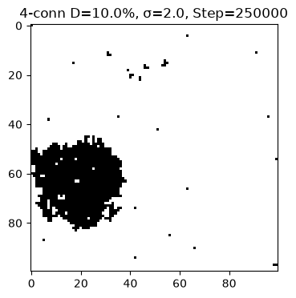
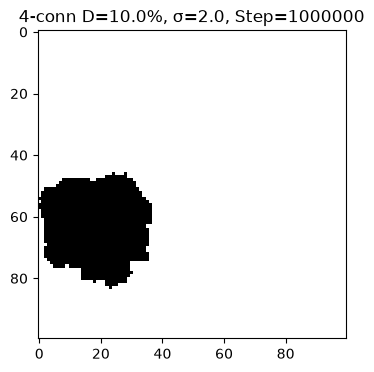
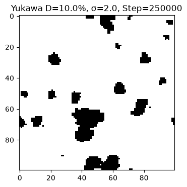
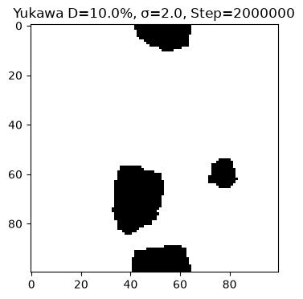
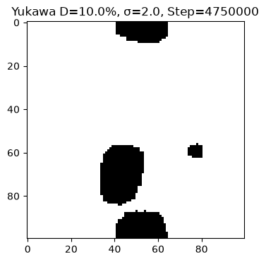
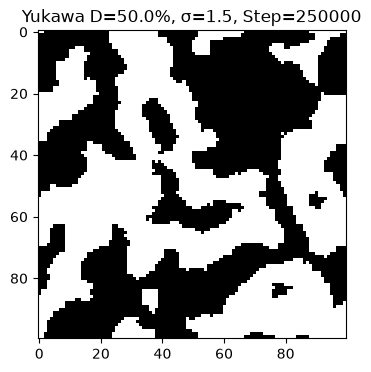
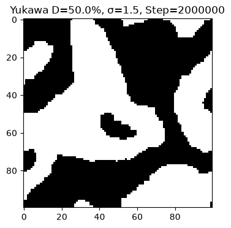
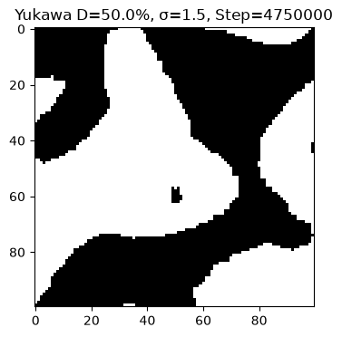
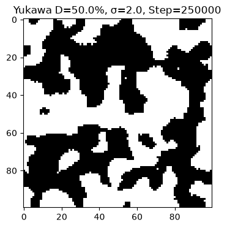

# Theoretical Foundation of the Plexon Network Model of Phase Transitions and Large-Scale Structure of the Universe

*Theory, notation glossary, methodology, results, comparison with Yadav (2026).*

*English translation of the main Russian document `THEORY.md`.*

---

## 1. Introduction: from phenomenology to microscopy

Modern studies of the large-scale structure (LSS) of the Universe increasingly employ thermodynamic approaches. In the work of Nitish Yadav (2026) [1], the Cahn–Hilliard equation — the classical model of spinodal decomposition of polymer mixtures — is applied to a "two-component fluid" (matter + dark energy) and reproduces voids, walls, and filaments in agreement with the DES and Subaru surveys. This is a macroscopic, phenomenological approach: it postulates a fluid and solves a continuum equation, but does **not explain what the fluid is made of**.

In this work we propose a **microscopic mechanism**. We hypothesise that spacetime consists of discrete nodes — **plexons** — and that gravity, mass, and large-scale structure arise from their **aggregation**. The interaction is described by the **Yukawa potential** — a soft field decaying with distance, mathematically analogous to the inductive effect in polymer chains (a substituent's influence fading over 4–5 bonds).

Thus, where Yadav models the *consequence* (a fluid separates into phases), we model the *cause* (discrete elements aggregate, producing the same phases).

> **Status of the model.** This is a *toy model*, but a deliberate first, partial test of the hypothesis in 2D (with a planned 3D extension): it shows that the plexon aggregation mechanism actually produces the expected structures — binodal droplets and a spinodal network — i.e. it is *consistent* with the hypothesis. The 2D lattice, however, models only the aggregation step and does not simulate spacetime directly; strengthening the case requires the 3D generalisation and comparison with astrophysical data. What is and is not tested — §5, §11–§12.

> **Status of the work.** This is a first, preliminary examination of the hypothesis, written by an author whose background is a **polymer chemist** rather than professional cosmology. This is not a weakness but a chance to look at the problem of cosmology from another angle — the angle of polymer physics: phase separation arising in polymer-analogous transformations and the closely related binodal/spinodal decomposition; this toolkit is central here (the Cahn–Hilliard framework itself comes from chemical physics — J. W. Cahn was a metallurgist; J. E. Hilliard a chemical engineer). The work deliberately restricts its claims to what the 2D model demonstrates and marks every untested part of the hypothesis explicitly; its aim is to open a discussion, not to announce a finished theory, and to try oneself in Python code.

## 2. What is a plexon and where does matter come from

**A plexon is not a particle flying through a void. It is a node of a network.** A plexon is a fundamental entity: not a particle, not a wave, not a point in space. The network constitutes spacetime itself; a plexon is not "in" spacetime — it *makes* it. No node — no network.

A simple analogy — a fishing net: the knots are the plexons, the threads are the links, the cells are voids (space). Stretch the net and the cells grow; compress it and they shrink; the knots remain knots and the threads remain threads. As a first approximation we consider the network in 2D (a net "laid on a table") and ignore both the three-dimensionality of the network itself and the 3D volume in which it is embedded.

**Gravity as the tension of the network (an analogue of elastic forces).** From the very beginning we treat gravity **not as a fundamental force between masses but as the tension of the plexon network** — by analogy with the elastic forces in a stretched net. A clump of N nodes (an aggregate) locally pulls and strains the neighbouring links; the network relieves this stress by drawing the neighbouring nodes toward the clump — like a stretched thread pulling back. The more nodes are gathered in the clump (the larger the mass), the stronger the local tension and the stronger the pull: the attraction turns out to be proportional to the mass, with no "mystical action at a distance". Both bodies experience an equal and opposite tension (F = −F), but the body with fewer nodes (less inertia) accelerates more — this is the falling asymmetry. **An important caveat:** our network is **labile** — links break and re-form, nodes aggregate, the topology changes. "Elasticity" here is therefore a metaphor of tension, not the classical theory of elasticity with fixed (Hookean) springs: a fixed lattice yields only linear elasticity, not gravity. The nonlinearity required for gravity arises from aggregation and percolation, not from Hooke's law.

**About the term.** We introduce and use the term "plexon" (from Latin *plexus*, "plait/weave") in a **new, specific sense** — "a node of the network that constitutes spacetime"; in physics and cosmology the word is unclaimed in this meaning.

> Importantly, the word itself is **not unique**: it exists outside physics (the company **Plexon Inc.** — neuroscience instruments, a registered trademark; the Plexon AI service; an anatomical term in some zoological ontologies), so our term is not a new *word* but a new *physical meaning*. We originally used "chronon", but it is overloaded in the literature (Lévi's 1927 quantum of time; the khronon of Hořava gravity; chronon field theory), so a fresh term was adopted; the theory is called the **plexon network theory of gravity (ПСТ)**.

**Aggregation and mass.** A plexon has a "weight" — a measure of presence. A single plexon has weight 1; an aggregate of N plexons has weight N. **Mass is a collective property of aggregation, not an intrinsic property of a particle**: the mass of an aggregate is proportional to N (M ∝ N). This is the gravitational "charge".

Scales: a single plexon N = 1; a small cluster N ≈ 10; an atom N ≈ 10⁶⁰; a star N ≈ 10¹²⁰; a black hole N → ∞ *(an illustrative estimate of the hypothesis, not a calculation — given only as an image, not used in the numerics)*.

**Field–body dualism.** A single plexon, or a rarefied network, behaves as a **field**; an aggregate, or a dense network, as a **body**. Not two different objects, but two regimes of one network — like water and ice.

## 3. Energy of the system and the notation glossary

The system minimises its free energy. In the model the energy (action) is

**S = −λ·Σ N² + σ·Perimeter**,

and in the Yukawa-field variant

**S = −(1/2)·J0 · Σᵢ Σ_{j≠i} (e^(−μ rᵢⱼ) / rᵢⱼ) · Nᵢ Nⱼ + σ · Perimeter**.

**Operator legend:**
- **Σ N²** — the sum over all clusters of the squared number of nodes N in the cluster (the minus sign: aggregation is favourable).
- **Σᵢ Σ_{j≠i}** — the double sum over all pairs of **distinct** nodes (j ≠ i): a node does not interact with itself (at j = i the distance r = 0 and the 1/r force diverges).
- **Nᵢ, Nⱼ** — the occupancy of a node: 1 = plexon (occupied), 0 = empty; the term is non-zero only for occupied nodes.
- **rᵢⱼ** — the distance between nodes i and j (in lattice cells).
- **e^(−μ rᵢⱼ) / rᵢⱼ** — the Yukawa potential: 1/r is the long-range part, e^(−μr) the screening.
- **J0** — the attraction strength (amplitude); **μ** — the screening parameter; **σ** — the surface tension; **Perimeter** — the total length of the matter/void boundary.
- **½** — the factor removing the double counting of each pair (i,j) and (j,i) in the full sum. It is not needed in the code: the energy is computed locally (per occupied node), so each pair is counted once.

**Notation glossary** (what is what):

| Symbol | Name | Meaning in the model | Value |
|---|---|---|---|
| **λ (lambda)** | aggregation strength | how energetically favourable sticking is (the minus sign in −λΣN² means aggregation is favourable); λc — the aggregation threshold | λ = 3.0 (in 4-connectivity) |
| **σ (sigma)** | surface tension | the penalty for ragged boundaries (the +σ·Perimeter term); a "poor solvent" squeezing a coil into a globule | list 0…50 (see §7) |
| **β (beta)** | inverse temperature | thermal noise (1/kT); a move is accepted if ΔS ≤ 0 or with probability exp(−β·ΔS) | β = 1.0 |
| **J0** | Yukawa attraction strength | the amplitude of the potential; "how much plexons like each other"; raised "so that attraction beats entropy" | J0 = 3.0 |
| **μ (mu)** | Yukawa screening parameter | the inverse screening length ("field mass"); the larger μ, the faster the force decays | μ = 0.5 |
| **r_cutoff** | cutoff radius | interactions are counted only within 4 cells ("that same 5th atom"); at the 4th cell the force is ≈ e⁻² ≈ 0.13 | r_cutoff = 4 |
| **P_inf** | giant-cluster fraction | size of the largest cluster / total particle number; 0 — all dispersed, 1 — a monolith | see tables |
| **Perimeter** | perimeter (boundary) | total number of edges where an occupied cell touches an empty one; the lower, the more compact | see tables |
| **Max_Size** | largest-cluster size | the absolute number of particles in the largest cluster (read together with P_inf) | see tables |
| **density** | actual density | the measured fraction of occupied nodes (should match the set value) | 0.5 %, 1 %, 10 %, 50 % |

**Algorithm.** Metropolis Monte Carlo with an occupied↔empty node swap — the total particle number (density) is conserved. A move is accepted if ΔS ≤ 0, otherwise with probability exp(−β·ΔS).

**Boundary conditions.** A 100×100 lattice with **periodic boundary conditions (a torus)**: it closes onto itself.

## 4. What is Yukawa (detailed report)

### 4.1. Historical note

In 1935 the Japanese physicist Hideki Yukawa sought a formula for the strong interaction holding protons and neutrons in the nucleus. Ordinary forces (gravity, electricity) fall as 1/r² and act infinitely far — but the nucleus is too small. Yukawa proposed that the force is carried by particles (mesons) **that have mass**: a massless carrier (photon) gives an infinite-range 1/r² force; a massive one makes the field "tire" and decay exponentially.

### 4.2. The formula and its terms

**V(r) = −J0 · e^(−μ r) / r**

- **r (distance)** — the farther apart two plexons are, the weaker the force.
- **1/r (geometry)** — the force spreads in all directions (like ripples on water), so it falls inversely with distance.
- **e^(−μr) (screening)** — the key factor: with μ > 0 the force decays exponentially. At μ = 0.5, at 5–6 cells the force becomes negligible. This is "screening" — as if a medium stood between the plexons, damping their attraction.
- **J0 (strength)** — the amplitude: how strongly plexons attract. If J0 = 0 there is no attraction.

### 4.3. Why we need it (the breakthrough over 4-connectivity)

In 4-connectivity a plexon feels only its 4 touching neighbours: if the neighbouring cell is empty, there is no interaction. Yukawa makes the plexons "soft": each plexon creates a field (halo) of radius 4 cells and attracts everything within it. This matches (a) the inductive effect in polymers and (b) real gravity, where bodies act on each other through space, not only on contact.

### 4.4. Why r_cutoff = 4

Computing "all against all" is O(N²) (the computer would "die"). We cut the radius at 4 cells: at μ = 0.5 the force at the 4th cell is e⁻² ≈ 0.13 of the original — beyond that it can be neglected. This is a standard molecular-dynamics practice.

## 5. The flexible J0 and "damping along the chain" (inductive effect)

The "flexible J0" idea came from polymer chemistry. In a macromolecule, a substituent's electron-density shift affects at most ~5 carbon bonds: between atoms 1 and 6 the influence is infinitesimal and does not materially affect the 1–2 bond. The influence decays **gradually but never vanishes abruptly**.

The proposal to set the interaction by hand — J(1)=3, J(2)=1, J(3)=0.5, J(4)=0.01 — is in fact already realised by the Yukawa function: at J0 = 3 and μ = 0.5 the forces at distances 1, 2, 3, 4 are ≈ 1.82, 0.55, 0.22, 0.10. That is, **Yukawa *is* the "flexible J0"**: a smooth decay of the coupling along the chain. If the decay is made unnaturally sharp (a cutoff at the 4th neighbour) one gets hard 4-connectivity; if smooth (Yukawa) one gets a soft field able to form smooth structures.

The same logic underlies the idea of **lability**: in a real network, bonds break and re-form, and on re-formation the influence of another body can be incorporated. In this 2D model the lattice is fixed (nodes occupy/free), and "lability" is effectively modelled precisely by the decaying Yukawa field.

## 6. Binodal and spinodal decomposition: how structure is born

Phase separation in a polymer solution proceeds by two mechanisms, separated on the Gibbs free-energy diagram G(c):

- **Binodal** — the metastability boundary; decomposition proceeds by **nucleation and growth**: isolated nuclei form and grow.
- **Spinodal** — the region where the homogeneous mixture is **absolutely unstable** (∂²G/∂c² < 0): any microscopic density fluctuation grows instantly and the system spontaneously separates into two phases.

**The key relation (our hypothesis):** if the **rate of growth of particles exceeds the rate of their formation**, this is **binodal** and one obtains *isolated particles* (few nodes). If the **rate of formation of nodes exceeds their growth rate**, a **gel** forms (a contiguous network). **The upper bifurcation point = the Big Bang** — the moment the system loses stability.

In our model the concentration c is the plexon density and the Gibbs energy is the action S. **The density selects the regime:**

- **Low density (10 %)** → **binodal decomposition**: isolated smooth droplets (globules). Cosmological reading — the birth of individual objects: galaxies and their clusters.
- **High density (50 %)** → **spinodal decomposition**: a bicontinuous network (gel) with voids and filaments threading through each other. Cosmological reading — the **cosmic web** (filaments and voids).

Further consequences (hypotheses, see §11): dark matter = the "gel skeleton" (aggregated plexons not yet collapsed into stars); dark energy = the "solvent" (the rarefied background of single plexons).

### 6.1. Ostwald ripening — what it is and how it appears in the model

**What it is.** Ostwald ripening is the process by which large droplets "eat" small ones, taking place **after** the phases have separated. It is named after the German chemist **Wilhelm Ostwald**, who described it in 1896 for precipitates and emulsions.

**The physical cause.** A small droplet has a larger surface-to-volume ratio than a large one. Because of surface tension (Laplace pressure ∝ 1/r), matter on the convex surface of a small droplet has a **higher chemical potential** than on a large one. Matter therefore "dissolves" from small droplets and "deposits" on large ones: **large grow, small vanish**. The total number of droplets falls, the average size grows, and the total boundary area (surface energy) drops.

**How it looks in our data (Yukawa, 5M steps).** Exactly this picture is observed:

| Signature | Direction | Example (10 %, σ=2.0) |
|---|---|---|
| P_inf (giant-cluster fraction) | grows | 0.299 → 0.483 |
| Perimeter (total boundary length) | falls | 574 → 218 |
| Max_Size (largest-cluster size) | grows | 292 → 472 |

The largest cluster grows by absorbing small ones while the total matter/void boundary shrinks — that is Ostwald ripening.

**Why 4-connectivity does not show it.** The hard 4-connectivity collapses at once into a single monolith (P_inf → 1.0 already by 500,000 steps) and "freezes": only a slow boundary smoothing follows, but re-topologisation (absorbing small clusters) is no longer possible. Ostwald ripening is a **dynamical rearrangement process**, so it appears only in the soft Yukawa field.

**Cosmological meaning.** Ostwald ripening is the analogue of galaxy merging and the coarsening of clusters over time: small structures are absorbed by large ones, the network/droplets coarsen. This is the "living evolution" of large-scale structure, as opposed to the frozen monolith of 4-connectivity.

## 7. Methodology

### 7.1. Model parameters

| Parameter | Value |
|---|---|
| Lattice | 100×100 = 10,000 nodes |
| Boundaries | periodic (torus) |
| Algorithm | Metropolis, occupied↔empty swap (density-conserving) |
| β (inverse temperature) | 1.0 |
| J0 / λ (attraction) | {0.0, 0.5, 1.0, 3.0} (screening); 3.0 (deep dive) |
| μ (screening) | 0.5 (fixed at the screening stage) |
| r_cutoff | 4 |
| Densities | {0.005, 0.01, 0.1, 0.5} → 0.5 %, 1 %, 10 %, 50 % |
| σ (tension) | {0, 0.25, 0.5, 1, 1.5, 2, 2.5, 5, 7.5, 10, 15, 25, 50} |

**Hardware.** The computations were carried out on a desktop computer (custom build): Windows 10 Pro 22H2 (64-bit); CPU AMD FX-6300 (6 cores) @ 3.5 GHz; GPU NVIDIA GeForce GTX 1650 (4 GB); RAM 16 GB.

### 7.2. Stage 1 — screening

Full matrix: 4 couplings × 4 densities × 13 σ = **208 combinations**, each **20,000 steps** (20,000 × 5 = 100,000 moves). A fast draft run to locate the "interesting" transition points on the P_inf(σ) and perimeter curves. Screening results (fragment, 20k steps; 4-connectivity λ=3.0 vs Yukawa J0=3.0):

| Density | σ | 4-conn P_inf | Yukawa P_inf | 4-conn perimeter | Yukawa perimeter |
|---|---|---|---|---|---|
| 10 % | 0.0 | 0.995 | 0.004 | 1834 | 3608 |
| 10 % | 2.0 | 0.942 | 0.088 | 618 | 1032 |
| 10 % | 10.0 | 0.636 | 0.098 | 936 | 976 |
| 10 % | 50.0 | 0.796 | 0.098 | 856 | 1074 |
| 50 % | 0.0 | 1.000 | 0.048 | 8654 | 10056 |
| 50 % | 2.0 | 1.000 | 0.734 | 2886 | 2628 |
| 50 % | 10.0 | 1.000 | 0.353 | 2792 | 2576 |

Observations: 4-connectivity collapses at once into one cluster (P_inf ≈ 1); Yukawa at 10 % keeps a low P_inf (many separate droplets — binodal), at 50 % gives a "loose", dynamic gel (spinodal).

> Shown is a fragment (key rows); the **full data for all 208 combinations is in `data/screening/`** (the file contents and the parameter matrix — in [data/screening/README.md](data/screening/README.md)).

### 7.3. Stage 2 — deep dive

Four "interesting" points (the gas → structure transition) were selected and run long: **4-connectivity 2.5 million steps**, **Yukawa 5 million steps**. In the code the outer loop runs ×5, hence 500,000×5 = 2.5M and 1,000,000×5 = 5M.

### 7.4. Corrected bugs (important for reproducibility)

1. **The "checkerboard".** In early Yukawa runs the system drifted into a perfect checkerboard (P_inf ≈ 0.001, a gigantic perimeter). Cause — **an error in the local-perimeter coefficient**: the formula `4 − 2·neighbors` instead of `4 − 1·neighbors`. Because of the extra factor of two the code believed that sticking *increased* the perimeter, so σ acted "in reverse" (tearing clusters apart). Fixed by honestly counting open edges in a 5×5 window.
2. **Double counting of the Yukawa energy** — when two nearby nodes were swapped their mutual interaction was counted twice; fixed.
3. **Order of the perimeter measurement** — the perimeter was measured after the swap had already been applied; fixed.
4. **Performance** — the perimeter was vectorised with `np.roll`; matplotlib (axes/text) was replaced by PIL for draft frames (matplotlib is used in the deep dive).
5. **Checkpoints** — reading CSV and skipping already-computed points (protection against crashes/interruptions).
6. **Off-by-one** — the final snapshot at 5,000,000 steps was not saved (the condition `real_step % 250_000 == 0` fails on the last iteration 4,999,995); the last saved frame is 4,750,000 (2,250,000 for 4-connectivity). This does not affect the morphology (~5 % of the time), but the captions state it honestly.

## 8. Justification of the choice of the four points

**Why λ = J0 = 3.0, not 1.0:** at λ/J0 = 0.5–1.0 the thermal noise (β = 1.0) tears the bonds — the system behaves as a gas. The value 3.0 is the regime of strong attraction where aggregation dominates the noise and real droplets and gel are born.

**Why densities 10 % and 50 %:** 10 % is a rarefied medium → binodal (isolated droplets); 50 % is dense → spinodal (a contiguous network). Densities 0.5 % and 1 % are "dust": no macrostructure is visible there.

**Why exactly these points (from the "sawtooth" perimeter curve of the screening):**
- **4-connectivity**: (10 %, σ=2.0) — the sawtooth minimum (perimeter 618); (10 %, σ=2.5) — the jump (perimeter 972); (50 %, σ=1.5) — the sharp perimeter drop at gel formation; (50 %, σ=2.0) — the plateau (stable gel).
- **Yukawa**: (10 %, σ=2.0) — the binodal zone, droplets; (10 %, σ=10.0) — strong tension; (50 %, σ=1.5) — the spinodal zone, gel; (50 %, σ=2.0) — stable gel.

At 10 % density the models differ: 4-connectivity takes σ=2.5 (the perimeter jump), Yukawa takes σ=10.0 (strong tension); at 50 % both take σ=1.5 and σ=2.0.

## 9. Results

### 9.1. 4-connectivity (2.5M steps) — the "frozen monolith"

| Point | P_inf | Perimeter | Max_Size |
|---|---|---|---|
| 10 %, σ=2.0 | 0.967 → **1.0** (from 500k) | 432 → 152 | 996 → 1030 |
| 10 %, σ=2.5 | 0.982 → **1.0** | 402 → 152 | 976 → 994 |
| 50 %, σ=1.5 | **1.0** (at once) | 2214 → 1042 | 4934 |
| 50 %, σ=2.0 | **1.0** (at once) | 2140 → 1004 | 5024 |

Conclusion: the system rapidly forms a single percolating cluster (P_inf → 1.0) and thereafter only slowly smooths its boundary (perimeter falls), **without re-topologising**. Visually — hard "square" structures with right angles (an artifact of the crystal lattice). The model cannot evolve dynamically — unsuitable for cosmology.

*Evolution of 4-connectivity (10 %, σ=2.0): 250k → 1M → 2.25M steps. An angular monolith; the perimeter falls, the topology does not change.*

### 9.2. Yukawa (5M steps) — "living evolution" (Ostwald ripening)

| Point | P_inf (250k → 5M) | Perimeter (250k → 5M) | Max_Size |
|---|---|---|---|
| 10 %, σ=2.0 | 0.299 → **0.483** | 574 → 218 | 292 → 472 |
| 10 %, σ=10.0 | 0.392 → **0.637** | 562 → 236 | 403 → 655 |
| 50 %, σ=1.5 | 0.688 → **0.799** | 1312 → 588 | 3376 → 3922 |
| 50 %, σ=2.0 | 0.688 → **0.720** | 1370 → 588 | 3482 → 3644 |

Per point:

- **(10 %, σ=2.0)** — binodal decomposition: isolated smooth droplets slowly merge (P_inf 0.30→0.48), the perimeter nearly thirds (574→218). Ostwald ripening: large droplets absorb small ones.
- **(10 %, σ=10.0)** — the same at strong tension: more compact droplets; P_inf reaches ~0.64 and **plateaus** (~0.637 by 3.5–5M).
- **(50 %, σ=1.5)** — spinodal decomposition: a bicontinuous network; P_inf 0.69→0.80, still growing at the end (no saturation).
- **(50 %, σ=2.0)** — a stable gel; P_inf plateaus at ~0.72 (the last three readings 0.719/0.720/0.720).

Evolution of P_inf (Yukawa, 5M; full series — in `data/yukawa_5M.csv`):

| Step | 10 %, σ=2.0 | 10 %, σ=10.0 | 50 %, σ=1.5 | 50 %, σ=2.0 |
|---|---|---|---|---|
| 250k | 0.299 | 0.392 | 0.688 | 0.688 |
| 1M | 0.380 | 0.514 | 0.729 | 0.704 |
| 2M | 0.459 | 0.567 | 0.757 | 0.706 |
| 3M | 0.452 | 0.609 | 0.777 | 0.716 |
| 4M | 0.467 | 0.638 | 0.788 | 0.719 |
| 5M | 0.483 | 0.637 | 0.799 | 0.720 |

*Evolution of Yukawa (10 %, σ=2.0): 250k → 2M → 4.75M steps. Smooth droplets; binodal decomposition + Ostwald ripening.*

*Evolution of Yukawa (50 %, σ=1.5): 250k → 2M → 4.75M steps. A bicontinuous network (the cosmic web).*

> **About the plateau (honestly).** Full thermodynamic equilibrium was not reached at 5 million steps. The growth of P_inf decelerates (resembling an exponential approach to saturation): points (10 %, σ=10.0) and (50 %, σ=2.0) plateau, while (10 %, σ=2.0) and (50 %, σ=1.5) keep growing slowly. Confirming saturation requires longer runs (of order 10–15 million steps).

### 9.3. Comparison with the preliminary run (2.5M)

The 2.5M (Yukawa) data give the same picture qualitatively but smaller values (different random seeds): (10 %, σ=2.0) 0.324→0.440; (10 %, σ=10.0) 0.178→0.291; (50 %, σ=1.5) 0.896→0.939; (50 %, σ=2.0) 0.717→0.881. This confirms that **5M is the main result** and 2.5M is preliminary (the seed sensitivity is stated explicitly).

### 9.4. Animations (GIF)

Full evolution (embedded animations; they play inline on GitHub):

All 12 animations — in the [`gif/`](gif/) folder; frame sets for self-stitching — in `gif_assemble/`.

## 10. Comparison with Yadav (2026)

We read the article [1] and its supplementary code. The comparison:

> **About the terms "micro/macro".** Here they refer to the *level of description of the model*: Yadav solves a continuum concentration field (a macro-description), we move individual discrete elements — plexons (a micro-description). Both approaches describe **one and the same object** — the large-scale structure of the Universe.

| Criterion | Yadav (2026) | This work |
|---|---|---|
| Approach | macroscopic, phenomenological | microscopic, discrete |
| Equation | Cahn–Hilliard (continuum PDE) | Metropolis on a lattice (plexons) |
| Potential | double well f(c)=αc²(1−c)² | Yukawa J0·e^(−μr)/r + σ·Perimeter |
| Density | fixed c0 = 0.317 (Planck Ωm) | swept 0.5–50 %, binodal/spinodal separated |
| Regimes | spinodal only (bicontinuum) | **binodal (droplets) vs spinodal (gel)** |
| Model comparison | none | **4-connectivity vs Yukawa** |
| Ostwald ripening | mentioned | **observed in the data** |
| Grid/resolution | 1000×1000, 500 steps, FFT | 100×100, 2.5–5M steps, MC |
| Metrics | void fraction 0.416, filamentarity 0.42, P(k), growth factor | P_inf, perimeter, Max_Size |
| Code | available (supplementary Python) | available (open, reproducible) |
| Connection to data | DES/Subaru, Planck 2018 | not yet (future work) |

**Key differences to state honestly:**

1. **Yadav has code.** Contrary to an early discussion in the chat, the full Python script is published in the supplementary material (`BMS-CPHS-2025-15-Suppl-MS.pdf`). Our advantage is not "he has no code" but **different physics and a reproducible two-model comparison**.
2. **Yadav knows about binodal/spinodal** (the phase diagram in his Fig. 1c and a ∂²f/∂c² check in his code), **but does not develop the binodal/spinodal dichotomy as two regimes and does not sweep the density**. He fixes c0 = 0.317 and stays in the spinodal region. **We, in this context, observe both regimes as a function of density for the first time**: 10 % → binodal isolated droplets (galaxies), 50 % → a spinodal bicontinuous network (the web), plus an explicit comparison of hard 4-connectivity with soft Yukawa.
3. **Positioning:** we provide a microscopic mechanism that produces the same structures Yadav describes macroscopically. **Caveat (a hypothesis requiring derivation):** the claim that the Cahn–Hilliard equation is the coarse-grained limit of our discrete model has **not been formally derived** — until it is, it remains a hypothesis, not a fact. The formal derivation is a separate future task.

**Our main contribution (in short).** We (1) **discovered and reproduced both regimes** — binodal (isolated droplets at 10 %) and spinodal (a bicontinuous network at 50 %) — as a function of density, which is absent in Yadav's work; and (2) showed that our discrete model reproduces the **same qualitative morphology** (droplets/filaments/voids) as Yadav's macroscopic Cahn–Hilliard equation. **Boundary of honesty:** this is a qualitative (morphological) correspondence; the quantitative comparison (void fraction, filamentarity, power spectrum, overlay on DES) has not been performed — that is the next stage.

---

## Part III. Justification and reference materials

*Sections 11–14: the full statement of the hypothesis, the honest boundaries of the work, the file inventory, and the references.*

## 11. The theoretical hypothesis (full statement)

> The section below is the **full statement of the hypothesis** (the same as in the preprint, Part I). The 2D run directly tests only its aggregation/phase-separation part; the rest is hypothesis. What is and is not confirmed — at the end of the section.

### 11.1. The starting question: what is gravity

Two bodies attract; the forces are equal and opposite, yet the small one "falls" toward the large one and not vice versa. This asymmetry is a property not of the force but of **inertia**, and it unfolds in time. Hence the move from "a particle in a void attracting another particle" to "a network of nodes in which a dense clump of nodes pulls on the rest of the network".

### 11.2. The plexon network

Spacetime is not a continuum in which particles move but a **network whose nodes are the elementary entities**. A node is not a particle, not a wave, not a point; it is a knot of the network. The term **plexon** (Latin *plexus*, "plait/weave") is used in a new physical sense (on the origin of the term — §2). Analogy — a fishing net: the knots are the plexons, the cells are space.

### 11.3. Aggregation and mass

A single plexon has "weight" 1; an aggregate of N plexons has weight N. **Mass is a collective property of aggregation**: M ∝ N. A single plexon / rarefied network — **field**; an aggregate / dense network — **body**. Two regimes of one network, like water and ice. (Illustrative, not computed, scales: a cluster N ≈ 10; an atom N ≈ 10⁶⁰; a star N ≈ 10¹²⁰; a black hole N → ∞.)

### 11.4. Gravity as the elasticity (tension) of the network

Gravity is **not a fundamental force but the elasticity of the network**. A dense aggregate locally strains the network; the network relieves the strain by pulling neighbouring nodes toward the aggregate. The more nodes are gathered into a clump, the harder it pulls its neighbours — roughly, this yields the proportionality of attraction to mass. Two bodies experience equal and opposite tension; the lighter one (less inertia) accelerates more — reproducing the falling asymmetry of §11.1 without action at a distance.

### 11.5. Sign-alternation: a unified origin of dark matter and dark energy

A plexon carries a **sign q = ±1** that flips upon aggregation: a single plexon is "+", an aggregate is "−". The interaction:

**F = −G · q₁ q₂ · N₁ N₂ / r²** — *where q is the plexon sign (±1), N the number of plexons in an aggregate, r the distance, G a coupling constant.*

Consequences of a single postulate:

- **Dark energy.** The rarefied background of single ("+") plexons repels aggregates ("−"). A uniform background of far plexons produces a constant potential Φ ≈ 4πρ₀/μ² *(ρ₀ — the density of far plexons)* — an effective cosmological constant. Accelerated expansion = the background "solvent" pushing matter apart.
- **Dark matter.** Because the sign flips on aggregation, the attraction between aggregates grows **superlinearly** with N → galaxy rotation curves without a separate dark-matter particle.

In the standard picture DM and DE are different entities; here they are **one entity — the far plexons** — seen from two sides: near aggregates attract, the distant background repels.

### 11.6. Screening and the hierarchy of scales

A single plexon acts over a short range, a large aggregate farther. We encode this as a size-dependent screening length:

**μ²(N) = μ₀² / N^α** — *where N is the aggregate size; μ the inverse screening length; μ₀, α model parameters.*

The effective range grows with N (a black hole "feels" everything; a single plexon only its neighbours). The emergent pair potential is the screened (Yukawa) form:

**G(r) = (1/4πr) · e^(−μr)** — *the Green's function (the contribution of one plexon to the potential),*

which is exactly what the numerical part uses (§4). Hence a hierarchy of scales — plexons → quarks → protons → atoms → stars — as stable forms of one network; each level is an aggregate of the previous one (fractality, one set of rules).

### 11.7. The bubble wall and percolation

The observable Universe lies in the **thickness of the wall of an expanding "bubble"** (not on a surface, not in a void). Redshift is a visibility limit set by the density of the wall, not the edge of the Universe. The early homogeneous wall, saturated with plexons, underwent fluctuations: where the density grew, aggregation began; where it fell, voids opened; at some moment a **percolation transition** occurred — the homogeneous "film" separated into clusters and voids. (In the refined formulation: the bubble "did not burst" but underwent a **phase transition** — segregation, like oil and water, without tearing the metric.)

### 11.8. Formalisation: CDT and the action

To make the hypothesis computable, it was cast in the language of Causal Dynamical Triangulation (CDT), with an aggregation term and a surface term:

**S = −κ₂N₂ + κ₄N₄ + Δ(…) − λ Σ N² + σ Σ A_boundary** — *where κ₂, κ₄, Δ are the CDT constants; N₂, N₄ the simplex numbers; N the number of plexons in a cluster; A_boundary the boundary area.*

The aggregation term −λ Σ N² (the minus: aggregation is favourable) is the driver; the surface term +σ Σ A (tension) penalises ragged boundaries and forces compact globules. Gravity here is **emergent** — a consequence of a phase transition in the plexon network, not a fundamental force.

**What the 2D run confirms and what it does not.** Confirmed: plexon aggregation produces droplets (binodal) and a network (spinodal); the morphology depends on the density (10 % vs 50 %); a soft Yukawa field is necessary for smooth structures, 4-connectivity freezes. **Not confirmed:** plexons as the nodes of real spacetime; gravity as network elasticity; sign-alternation and its consequences (DM/DE); the screening dependence μ²(N)=μ₀²/N^α and the derivation of the Yukawa form; the bubble-wall geometry; the overlay on DES/Subaru; the tie of the densities to Planck Ωm=0.317; full equilibrium.

## 12. Limitations and honest boundaries

1. **Statistics.** Each point was run **once (one run, one seed)**; the variance over random initial conditions **has not been estimated**.
2. **We did NOT overlay** our simulations on sky maps (DES/Subaru) and did **not build** correlation functions. The visual morphological similarity (droplets/network) is discussed at the level of a phenomenological comparison with Yadav (2026). A direct overlay is the next stage.
3. The densities 10 % and 50 % are model values, **not tied** to Planck Ωm = 0.317 (which Yadav uses).
4. Full equilibrium was not reached (10–15M steps are needed).
5. GPU (PyTorch/CuPy) **gave no speedup** for this task — the final runs are CPU. The GPU-variant code is in `experiments/` with an analysis of the causes (the sequential Metropolis loop + the small 100×100 lattice).
6. The Cahn–Hilliard equation was **not solved** by us (only discussed as the macro-limit).
7. The final snapshot at 5,000,000 steps was not saved (off-by-one) — the 4,750,000 frame is used (2,250,000 for 4-connectivity).

## 13. File and code inventory

**Data:** `4conn_2.5M.csv`, `yukawa_2.5M.csv`, `yukawa_5M.csv`, `summary_2.5M.xlsx` (in `data/`).

**Code:** `simulation_4conn_2.5M.ipynb`, `simulation_yukawa_2.5M.ipynb`, `simulation_yukawa_5M.ipynb` (in `src/`). GPU variants (PyTorch/CuPy, no speedup) — in `experiments/`. The correspondence to the original names — in `RENAME_MAP.md`.

**Figures:** evolution frames in `figures/` (by point and step, 250k…4.75M); animations in `gif/`; frame sets for self-stitching — in `gif_assemble/`.

**Literature for the analysis:** the Yadav article and his published code (supplementary) — in the source-materials folder (see `RENAME_MAP.md`).

## 14. References

1. N. Yadav, *A spinodal decomposition model for the large-scale structure of the universe*, Current Physics **3**, e27723348461389 (2026). DOI: [10.2174/0127723348461389260423123250](https://doi.org/10.2174/0127723348461389260423123250).
2. J. W. Cahn, J. E. Hilliard, *Free energy of a nonuniform system. I. Interfacial free energy*, J. Chem. Phys. **28**, 258 (1958). DOI: [10.1063/1.1744102](https://doi.org/10.1063/1.1744102).
3. V. Springel et al., *Simulations of the formation, evolution and clustering of galaxies and quasars*, Nature **435**, 629 (2005). DOI: [10.1038/nature03597](https://doi.org/10.1038/nature03597).
4. J. Schaye et al., *The FLAMINGO project: cosmological hydrodynamical simulations…*, MNRAS **526**, 4978 (2023). DOI: [10.1093/mnras/stad2419](https://doi.org/10.1093/mnras/stad2419).
